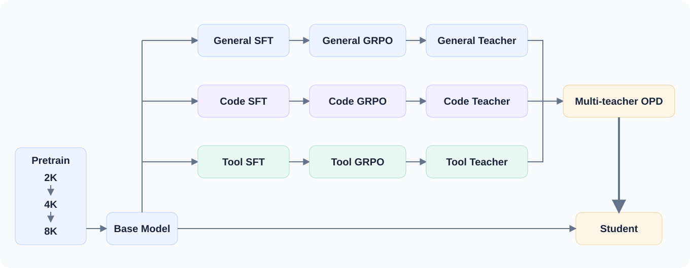
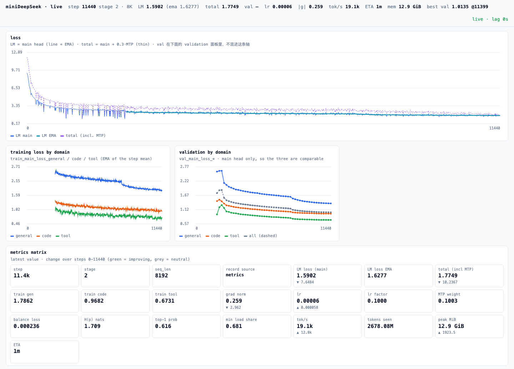
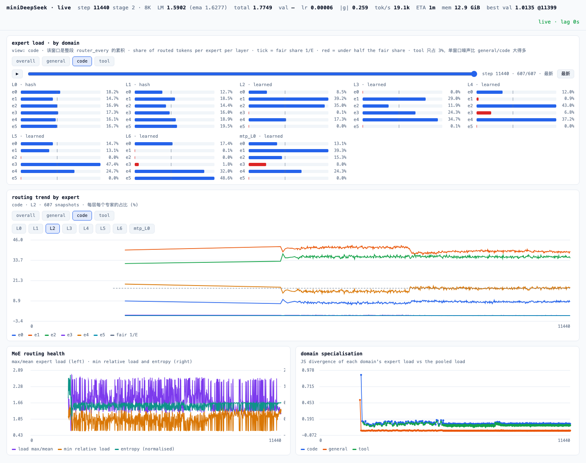

<div align="center">
  
</div>
<div align="center">


[](https://github.com/Alita02384/miniDeepSeek/stargazers)
[](LICENSE)
[](https://github.com/Alita02384/miniDeepSeek/commits)
[](https://github.com/Alita02384/miniDeepSeek/pulls)

</div>

<h3 align="center">用上最前沿的大模型技术，训练一个属于你自己的 LLM</h3>

<p align="center">
  <a href="https://modelscope.cn/datasets/Alita0429/mini-deepseek"><b>🤗 开源数据集</b></a> ·
  <a href="https://modelscope.cn/models/Alita0429/miniDeepSeek/files"><b>🤗 预训练模型权重</b></a> ·
  <a href="#-训练报告">📊 训练报告</a> ·
  <a href="#-快速开始">🚀 快速开始</a>
</p>

<p align="center">
  <b>145M 参数</b> · <b>DeepSeek-V4 同构</b> · <b>消费级 GPU 训练</b>
</p>

- miniDeepSeek 旨在解决前沿模型技术与初学者之间的壁垒，让初学者在自己的第一个项目中就应用上当下大模型领域中的最前沿技术。

---

# 🐳 项目介绍

对于想要训练语言模型的初学者而言，当前的领域呈现出一种割裂的状态：一方面，像 nanoGPT 和 MiniMind 这类易于上手的项目，基于经典的 Transformer 架构，但是目前前沿的大模型早已不用这种结构并加入了许多新的技术；另一方面，诸如 torchtitan 和 verl 等前沿技术栈，虽然集成了 MoE（混合专家模型）、压缩注意力机制、mHC、MTP、GRPO 和 OPD 等先进技术，但往往要求使用者具备集群环境以及对深度学习框架的深厚理解，让初学者难以上手。

换言之，当前初学者难以在自己的项目中实操运用上最前沿的大模型技术。这对许多怀抱着热情的初学者来说无疑是扫兴的。

miniDeepSeek 的目标正是解决这个前沿模型技术与初学者之间的鸿沟，让初学者在自己的第一个项目中就应用上当下大模型领域中的最前沿技术。miniDeepSeek 目前采用DeepSeek-V4 技术栈，涵盖了
DeepSeekMoE、Hash Routing、无辅助损失负载均衡、MLA、CSA/HCA、mHC、MTP、SwiGLU Clamp、Muon + AdamW 等技术。训练方法也采用同款分阶段预训练（2K → 4K → 8K）、领域 SFT、GRPO、多教师 OPD。

miniDeepSeek 是一个 145M-A60M 参数的语言模型。仅用一张 RTX 4090 就可以开始训练，也支持多卡比如 2 * RTX 4090D（这是我的配置）。

😊 一起感受探索的乐趣吧！

训练数据已开源：[在 ModelScope 下载数据集](https://modelscope.cn/datasets/Alita0429/mini-deepseek)

预训练模型已发布：[在 ModelScope 下载模型权重](https://modelscope.cn/models/Alita0429/miniDeepSeek/files)

---

# 🎯 完成这个项目你将会得到

## 1. 一个融合 DeepSeek 核心技术的 145M 的 MoE模型

你将从零搭建并训练一个 **145.84M 总参数、60.91M 激活参数**的语言模型，在可控的规模下理解这些技术的实现与作用。

| 技术 | 在模型中的实现 |
| --- | --- |
| DeepSeekMoE | 6 个路由专家，每个 token 通过 top-2 路由选择其中 2 个 |
| Hash routing | 前两层根据 token ID 的固定映射分配专家，后续层采用基于隐藏状态的学习式 top-k 路由 |
| Loss-free 负载均衡 | 通过路由偏置调节专家负载 |
| CSA / HCA 混合注意力 | 滑动窗口注意力结合两种压缩注意力 |
| MLA | 注意力中的低秩 q/o 投影 |
| mHC | 4 条残差流，使用 Sinkhorn 迭代进行混合 |
| MTP | 增加 1 层多 token 预测辅助训练 |
| SwiGLU clamp | 将激活值限制在设定范围内 |
| Muon + AdamW | 混合优化器：Muon 更新主要隐藏层权重矩阵，AdamW 更新 embedding、输出头及其他指定参数 |

## 2. 一套与 DeepSeek-V4 同款的完整训练流程




## 3. 详细的训练报告 📊
训练过程中会在 log 和 checkpiont 目录下记录详细的各项指标。
下面是我自己训练模型时生成的报告，用于效果展示（报告保存在 `reports/` 目录下）。

### 预训练：2K → 4K → 8K

[](https://raw.githack.com/Alita02384/miniDeepSeek/main/reports/curriculum_145m_3b_dashboard.html)

**MoE 专家分化与路由情况。**

[](https://raw.githack.com/Alita02384/miniDeepSeek/main/reports/curriculum_145m_3b_dashboard.html)

[打开完整预训练报告](https://raw.githack.com/Alita02384/miniDeepSeek/main/reports/curriculum_145m_3b_dashboard.html) · [查看 HTML 文件](reports/curriculum_145m_3b_dashboard.html)

### SFT：指令微调阶段记录
[](https://raw.githack.com/Alita02384/miniDeepSeek/main/reports/sft_dashboard.html)

[打开完整 SFT 报告](https://raw.githack.com/Alita02384/miniDeepSeek/main/reports/sft_dashboard.html) · [查看 HTML 文件](reports/sft_dashboard.html)

<details>
<summary>导出自己的训练报告</summary>

先用 `scripts/merge_metrics.py` 合并预训练各阶段的 metrics，再导出看板：

```bash
# 预训练
python3 scripts/live_dashboard.py --export pretrain_report.html --local-metrics metrics_full.jsonl

# SFT
python3 scripts/sft_dashboard.py --export sft_report.html --total-steps 4152
```

</details>

---

# 🚀 快速开始

## 第0步

```bash
# 克隆仓库、安装依赖
git clone https://github.com/Alita02384/miniDeepSeek.git
cd miniDeepSeek
python3.12 -m venv .venv
.venv/bin/pip install -e '.[dev]'
```

<details>
<summary>不需要 GPU，也不需要数据。验证代码环境不报错</summary>
  
```bash
# 2-step 训练 smoke → 一致性门禁 → 全量 CPU 测试
./scripts/debug_smoke.sh
```

看到 `365 passed, 2 skipped` 就说明模型前向/反向、checkpoint、路由和测试都正常。
如果只是想确认“这个仓库能跑”，到这里就够了；想真正训练，继续看下一节。

</details>

## Ⅰ 🛠️ 模型训练

<details>
<summary>注：提前确认 Torch 的可用后端</summary>

```python
import torch
print(torch.cuda.is_available())
```

项目按**多卡 CUDA**设计，最终训练以 CUDA 为准；CPU / MPS 只用于跑通逻辑与 debug 模型。
如需安装或更换 PyTorch 版本，可参考 [torch_stable](https://download.pytorch.org/whl/torch_stable.html)。

</details>

### 1' 下载数据

在项目根目录：

```bash
.venv/bin/pip install -U modelscope

# 预训练 tokenization 压缩包（约 3.4 GB）
modelscope download --dataset Alita0429/mini-deepseek packs.tar.zst \
  --local_dir data

# SFT / GRPO / OPD 等阶段使用的 JSONL
modelscope download --dataset Alita0429/mini-deepseek \
  --include '*.jsonl' --local_dir data

# 压缩包内已包含 data/tokenization/ 路径，在仓库根目录解压
zstd -dc data/packs.tar.zst | tar -xf -
```

压缩包中是经过 tokenize 后的预训练数据，存在`data/tokenization/` 下，可直接供预训练脚本使用，无需重新 tokenize。
后训练 JSONL 下载到 `data/`；训练前按对应配置完成 tokenize / pack。

### 2' 开始训练

<details>
<summary>💡 检查点暂停续训</summary>

所有阶段都支持断点续训，由 config 控制：

- `train.auto_resume: true`：自动从 `out_dir` 里最新的 checkpoint 恢复；
- `train.resume: <path>`：显式指定恢复的 base；
- `out_dir/final` 已存在且 resume 指向外部 base 时，启动前会直接报错，避免误覆盖。

检查点包含模型、优化器与训练进度；支持跨不同 GPU 数量恢复（按全局 token 数换算 step）。

</details>

#### 2.1 预训练（必须）

按卡数自动拆 micro-batch / grad_accum，262,144 token/step 不变：

```bash
.venv/bin/python scripts/autoconfig_145m.py --gpus 2
NPROC_PER_NODE=2 bash scripts/train_curriculum.sh \
  configs/pretrain/generated/curriculum_145m_g2.yaml
```

> 训练后，将得到 `checkpoints/curriculum_145m_3b/stage_*_seq*/final/` 作为输出权重。

#### 2.2 指令微调（必须）

把 `configs/sft/*.yaml` 里的 `train.resume` 指向你的预训练 checkpoint，然后：

```bash
for spec in general code tool; do
  bash scripts/train_sft.sh configs/sft/$spec.yaml
done
```

> 训练后，将得到 `checkpoints/sft_{general,code,tool}_145m/final/`。response-only mask，MTP loss 0.3 → 0.1。

#### 2.3 GRPO（可选）

```bash
for spec in general code tool; do
  bash scripts/train_grpo.sh configs/grpo/$spec.yaml
done
```

> general 用 1.8B reward model，code 用单元测试，tool 用 tool-call reward；
> 产物在 `checkpoints/grpo_{general,code,tool}_145m/final/`。
> general 需要先把 `internlm2-1_8b-reward` 奖励模型放到仓库根目录（约 3.2 GB）。

#### 2.4 多教师 OPD（可选）

```bash
bash scripts/train_opd.sh configs/opd/three_teacher.yaml
```

> student 自己采样，general / code / tool 三个 teacher 对同一轨迹算 full-vocabulary reverse KL，权重各 1/3。

## Ⅱ 📦 模型导出

```bash
.venv/bin/python scripts/export_hf.py \
  --checkpoint checkpoints/sft_general_145m/final \
  --out hf/mini_145m_a60m --flavor mini_145m_a60m
```

导出目录可用 `trust_remote_code=True` 加载，供 transformers / verl / vLLM 使用。

---

# 📚 数据介绍

## Ⅰ Tokenizer

沿用 MiniMind 的 **6,400** 词表 BPE tokenizer（[`tokenizer/`](tokenizer/)），含 ChatML 模板。
6,400 词表让 tied embedding 只占约 4.9M 参数，为模型本体省下更多参数，也是 OPD 做全词表 reverse KL、
GRPO 算全词表 logprob 的前提。**不要换词表**——换一次就要重训全部权重，并同步改所有 pack。

## Ⅱ Pretrain 数据

预算 3B token（实跑 **2.68B**：按 262,144 token/step × 11,444 步的预算，pack 填充率 76–95%，实际消费略低于预算），按 **general / code / tool = 82% / 15% / 3%** 混料，2K → 4K → 8K 三段互不重叠：

| 阶段 | token | 序列长度 |
|---|---:|---:|
| 2K | 0.450B | 2048 |
| 4K | 1.650B | 4096 |
| 8K | 0.900B | 8192 |

来源：MiniMind `pretrain_t2t`、fineweb-edu、chinese-fineweb-edu、cosmopedia-v2、finemath、
codeparrot-clean，以及 ToolACE / glaive 的 schema→call 文本。跨源精确去重后按预算哈希裁剪，
并对评测集做 13-gram 污染检查。

```jsonl
{"text": "Transformer 通过自注意力机制建模上下文关系，是现代大语言模型的重要基础结构。"}
```

## Ⅲ SFT 数据

三个 specialist 各自一套数据，response-only mask，领域数据 70–90% + general 10–30%：

| 专家 | 文档数 | loss token | 1 epoch 步数 |
|---|---:|---:|---:|
| general | 877,651 | 359.1M | 4,152 |
| code | 148,723 | 24.5M | 480 |
| tool | 99,552 | 6.9M | 285 |
| identity | 69 | 2.2k | 混入 general（权重 0.0002） |

三个域都是 **1 个 target epoch**（`configs/pipeline/posttrain_e2e_145m.yaml`），
identity 以 0.0002 的权重混进 general，约 15 遍，用来修正「你是谁」的自述。

MiniMind 语料里的旧身份（`jingyaogong / minimind / 小参数AI模型`）已用
[`scripts/scrub_identity.py`](scripts/scrub_identity.py) 清掉，并换成本项目身份。

```jsonl
{"conversations": [{"role": "user", "content": "你好"}, {"role": "assistant", "content": "你好！"}]}
```

## Ⅳ RL 数据

- **GRPO general**：`data/grpo_general_train.jsonl`（17,460 prompt），1.8B reward model + 长度/思考/重复惩罚。
- **GRPO code**：MBPP + open-r1 过滤后的可执行题，单元测试 + 编译/格式加权。
- **GRPO tool**：`data/grpo_tool_train.jsonl`（33,960 prompt），tool-call / 参数正确性 reward。
- **OPD**：9,135 prompt 池，general / code / tool 三个 teacher，full-vocab reverse KL。

```jsonl
{"prompt": "写一个函数计算列表均值", "reference_answer": "def mean(xs): ...", "rubric": "unit_test"}
```

## Ⅴ 训练数据集

训练数据已开源，无需自行预处理：[ModelScope](https://modelscope.cn/datasets/Alita0429/mini-deepseek)

```text
packs.tar.zst      # 2K/4K/8K 预训练 tokenization（train + val），约 3.4 GB 压缩
*.jsonl            # pretrain / SFT / GRPO / OPD / eval 的平铺数据
SHA256SUMS         # 下载后校验
```

---

# 🧠 模型

## 结构

每个组件的**计算方式**与 V4 对齐，而不只是“层数一样”：

- **混合注意力**：7 层按 `(0, 0, 4, 32, 4, 32, 4)` 排列，SWA window 128、CSA 压缩率 4、HCA 压缩率 32；CSA indexer top-k 1024@4K / 2048@8K。
- **mHC**：4 条 residual stream，Sinkhorn ×20 混合。
- **DeepSeekMoE**：前 2 层 token-id hash routing，其余 top-k 学习路由；`route_norm` + `route_scale=1.5`，loss-free 负载均衡 bias。
- **MTP**：depth 1 辅助 LM head，loss 权重 0.3 → 0.1。
- **其它**：SwiGLU clamp 10.0、MLA（q/o LoRA rank 288）、tied embeddings、Muon + AdamW。

<div align="center">
  
</div>

实现按职责拆在 [`src/minideepseek/model/`](src/minideepseek/model/)。state dict 的 key 和形状与参考实现一致，可以直接对照加载。

## 模型配置

| 模型 | 总参 / 激活 | 层 | FFN | 路由 | 用途 |
|---|---:|---:|---|---|---|
| `mini_145m_a60m` | 145.84M / 60.91M | 7 | 6 routed experts | top-2 | **当前主跑** |

配置：`dim=768`、7 层 + 1 层 MTP、`n_heads=12 / head_dim=64`、`vocab=6400`、`seq_len=4096`、
`max_context=8192`、`swiglu_limit=10.0`、`hc_mult=4`、`sinkhorn_iters=20`。
完整字段见 [`configs/model/mini_145m_a60m.yaml`](configs/model/mini_145m_a60m.yaml)。CPU 测试另用 `debugmodel`（12.98M）。

---

# 🧪 实验

## Ⅰ 训练开销

实测环境：2×4090D 或 1×4090 24GB，bf16：

| 项目 | 数值 | 条件 |
|---|---:|---|
| 预训练吞吐 | **30k tok/s** / 10.4 s/step | 2×4090D，DDP，262,144 token/step |
 |
| SFT 吞吐 | 18–20k tok/s | 2×4090D，DDP，4K，micro 8192×2，grad_accum 16，7.5 GiB |
| GRPO step | 18.6 s | 1×4090，16 prompt × group 6 × 512 token，9.0 GiB |
| KV-cache decode | 5.4 ms/step ≈ 12k tok/s | 1×4090，batch 64，CUDA graph |
| 3-teacher OPD | KL total 0.065 / 20 step | 9,135 prompt 池，约 17 s/step |

> 预训练已跑完 2K → 8K 全程（11,444 步，2.68B token）；表里都是实测值，不混计划值。

## Ⅱ 主要训练

| 阶段 | 配置 | 预算 | 产物 |
|---|---|---|---|
| 预训练 | `configs/pretrain/curriculum_145m_4x4090.yaml` | 11,444 步 / 2.68B token（预算 3B） | `checkpoints/curriculum_145m_3b/` |
| SFT | `configs/pipeline/posttrain_e2e_145m.yaml` | 4,152 / 480 / 285 步（各 1 epoch，357M target） | `checkpoints/posttrain_e2e_145m/sft_*/final/` |
| GRPO | `configs/pipeline/posttrain_e2e_145m.yaml` | 200 / 200 / 400 步 | `checkpoints/posttrain_e2e_145m/grpo_*/final/` |
| OPD | `configs/pipeline/posttrain_e2e_145m.yaml` | 100 步 | `checkpoints/posttrain_e2e_145m/opd_three_teacher/final/` |

## Ⅲ 其它训练

- **GRPO**：group 6、16 prompts/step、max_new 512、temperature 0.8、CISPO clip 0.2、KL 0；
  `rollout_backend=cached`。old logprob 由 actor 重算，ratio 从 1 开始（等价 on-policy REINFORCE + group baseline）。
- **OPD**：student 采样，三个 teacher 走 full-vocabulary reverse KL；loss 分母固定为 `Σw_i`，
  某步缺 teacher 不会放大剩余权重。
- **一致性门禁**：logprob / routing / checkpoint 三类检查，CPU debugmodel + 2 进程 DDP 覆盖。

---

# 🧰 其他

## 📁 目录结构

```text
miniDeepSeek/
├── src/minideepseek/
│   ├── model/        # V4 同构模型、attention/compressor、mHC、MoE、MTP、KV cache、routing
│   ├── data/         # JSONL、tokenize/pack、去重、污染检查、manifest、混料
│   ├── train/        # Muon+AdamW、curriculum、scheduler、metrics、trainer
│   ├── rl/           # rollout、GRPO、多教师 OPD、reward model、tool / agent rollout
│   ├── consistency/  # logprob / routing / checkpoint 一致性门禁
│   ├── eval/         # general / code / tool / math 评估
│   └── viz/          # 自包含 report.html（内联 SVG 图表）
├── configs/          # model / pretrain / sft / grpo / opd / eval
├── scripts/          # 环境、数据、训练、监控、benchmark、导出
├── tests/            # CPU 测试，全部使用 debugmodel
├── tokenizer/        # MiniMind 6,400 tokenizer + chat template
└── assets/           # logo / banner / 架构图
```

---

# 🙏 致谢

模型结构与训练方法来自 **DeepSeek-V4** 技术报告；参考实现与工程经验来自
[torchtitan](https://github.com/pytorch/torchtitan)、
[verl](https://github.com/volcengine/verl) 和
[MiniMind](https://github.com/jingyaogong/minimind)。
本项目把需要的部分**复制并重构**进自己的模块，保留代码中的版权头与来源说明；运行时**不依赖**这些仓库。
README 的视觉与章节风格参考 MiniMind。

Tokenizer 与基础数据来自 MiniMind；外部语料的使用须遵循各自来源的许可证。

## License

代码、数据、模型均以 [MIT License](LICENSE) 发布。

> DeepSeek 名称与蓝鲸标识归 DeepSeek 所有。README 里的蓝鲸标识是对其的非官方致敬，
> 不代表 DeepSeek 官方；标识字体为 Fredoka / DM Serif Display（SIL OFL），已转为路径，
> 详见 [`assets/README.md`](assets/README.md)。

---

<div align="center">
  <sub>如果这个项目对你有帮助，欢迎 Star ⭐ / 提 Issue / 发 PR。</sub><br>
</div>
