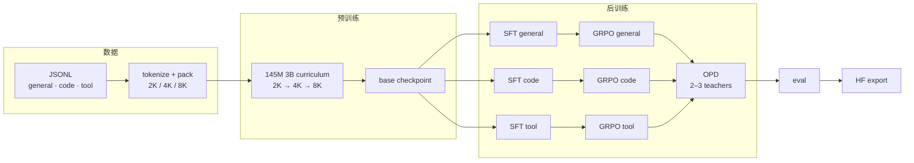

<div align="center">
  
</div>

<p align="center">
  <a href="https://www.python.org/"></a>
  <a href="https://pytorch.org/"></a>
  <a href="#快速开始"></a>
  <a href="LICENSE"></a>
  <a href="#当前进展"></a>
</p>

<h3 align="center">用 DeepSeek-V4 的架构与训练方法，从零复刻 60M–220M 级研究模型</h3>

<p align="center">
  <b>自包含</b> · <b>CPU 可验证</b> · <b>单机 4090 可跑</b> · <b>预训练 → OPD 全流程</b>
</p>

`miniDeepSeek` 是一个**研究方法复现**项目：把 DeepSeek-V4 的模型结构、训练阶段和数值门禁，
缩到一张 24 GB 显卡能跑通的规模。模型、tokenizer、数据管线、预训练 / SFT / GRPO /
多教师 OPD、一致性检查与评估全部在本仓库内，运行时不 import 任何同级参考仓库。

> [!NOTE]
> **这不是产品，也不追榜单。** 当前目标是把 V4 的 layer 类型、训练流程和数值正确性
> 在 60M–220M 规模上跑通、跑对，并把每个数字与取舍记录在 [`doc/`](doc/) 里。
> 目前主跑的是 **145M MoE**；220M / 60M 用于结构对照与 1-step 验证。

**快速跳转**：[快速开始](#快速开始) · [模型矩阵](#模型矩阵) · [架构](#架构与-v4-同构) · [训练流水线](#训练流水线) · [当前进展](#当前进展) · [文档地图](#文档地图)

---

## 一眼看懂

| 维度 | 内容 |
|---|---|
| 🧠 **模型** | 60M dense / 145M MoE / 220M MoE；7 层、6,400 词表、8K 上下文、MTP depth 1 |
| 🧬 **V4 同构** | SWA + CSA + HCA 混合注意力、mHC、DeepSeekMoE、SwiGLU clamp、Muon + AdamW |
| 🔁 **全流程** | 3B token 2K → 4K → 8K 课程预训练 → SFT → GRPO → 2/3-teacher OPD → eval → HF export |
| 🧪 **可验证** | 305 个 CPU 测试；router replay、logprob / routing / checkpoint 一致性门禁 |
| ⚡ **实测** | 2×4090D 预训练 **29.6k tok/s**；单卡 4090 SFT **6–7k tok/s**；GRPO **18.6 s/step** |

**为什么值得看：**

- **同构，不是“小号 Transformer”。** 三种注意力层型、mHC 的 Sinkhorn 混合、MoE 的
  hash routing / loss-free bias、MTP、Muon 优化器都按 V4 的数学实现，而不是只改小 `hidden_size`。
- **全流程，不是单点 demo。** 从平铺 JSONL 到 tokenize / pack、课程训练、三个 specialist
  的 SFT + GRPO、多教师 OPD、评估和 HF 导出，每一段都有可执行入口。
- **数字有出处。** 测试、吞吐、显存、loss 都对应仓库里的命令与 `doc/PROCESS.md` 记录；
  没跑过的项标为未验证，不填假数。

---

## 快速开始

**环境**：Python 3.11+（安装脚本默认 3.12）。CPU 可跑通全部测试；训练建议 24 GB 显存，
145M 的 3B 课程正在 2×4090D 上跑。

### 1. 两分钟验证代码（CPU）

```bash
git clone https://github.com/Alita02384/miniDeepSeek.git
cd miniDeepSeek

# 安装，二选一
./scripts/setup_env.sh                 # 需要 uv；默认找 $HOME/.local/bin/uv
# 或者
python3.12 -m venv .venv
.venv/bin/pip install -e '.[dev]'

# 2-step 训练 smoke → 一致性门禁 → 全量 CPU 测试
./scripts/debug_smoke.sh
```

最后看到 `305 passed, 2 skipped` 就说明环境、模型前向/反向、checkpoint、路由和测试都正常。
`setup_env.sh` 的 `uv` 不在默认路径时，用 `UV=/path/to/uv ./scripts/setup_env.sh`。

### 2. 准备数据

数据、tokenization 和 checkpoint 都不进 git（数据与 tokenization 合计约 38 GB）。`data/manifests/`
只保留来源、license 与统计信息。

```bash
# A. 最小可跑数据：从 MiniMind 公开数据生成平铺 JSONL
#    适合跑通 general/tool 的 SFT + GRPO 流程
git clone https://github.com/jingyaogong/minimind.git ../minimind
MINIMIND_ROOT=../minimind/dataset bash scripts/build_data.sh

# B. 复现 3B 语料：按 doc/data_plan_145m.md 准备
#    data/pretrain_general.jsonl / pretrain_code.jsonl / pretrain_tool.jsonl，
#    再在训练机打包 2K/4K/8K 的 train/val packs（压缩后约 3.4 GB）
bash scripts/build_pretrain_packs.sh
```

完整的 3B 数据来源、去重、配比与 license 见
[`doc/data_plan_145m.md`](doc/data_plan_145m.md) 和 [`doc/external_data.md`](doc/external_data.md)。

### 3. 训练 145M

```bash
# 按当前机器的卡数生成配置：micro-batch / grad_accum 自动拆，262k token/step 不变
.venv/bin/python scripts/autoconfig_145m.py --gpus 2

# 2K → 4K → 8K，3B token
NPROC_PER_NODE=2 bash scripts/train_curriculum.sh \
  configs/pretrain/generated/curriculum_145m_g2.yaml
```

后训练之前，把 `configs/sft/*.yaml` 里的 `train.resume` 指向你自己的预训练
checkpoint（默认值对应仓库开发时的运行目录）：

```bash
for spec in general code tool; do
  bash scripts/train_sft.sh  configs/sft/$spec.yaml
  bash scripts/train_grpo.sh configs/grpo/$spec.yaml
done

# general + tool + code 三个 teacher
bash scripts/train_opd.sh configs/opd/three_teacher.yaml
```

逐步的显存预算、迁移步骤和已知坑见
[`doc/run_145m_gpuhome.md`](doc/run_145m_gpuhome.md) 与
[`doc/posttraining_plan.md`](doc/posttraining_plan.md)。

### 4. 监控、评估与导出

```bash
# 离线训练报告（训练中由 train.report_every 自动刷新）
.venv/bin/python scripts/plot_training.py \
  checkpoints/curriculum_145m_3b/stage_00_seq2048 \
  --out checkpoints/report.html --meta model=mini_145m_a60m

# 评估
bash scripts/eval.sh configs/eval/general.yaml

# HF 格式导出（可选 extra：pip install -e '.[hf]'）
.venv/bin/python scripts/export_hf.py \
  --checkpoint checkpoints/opd_three_teacher_145m/final \
  --out hf/mini_145m_three_teacher --flavor mini_145m_a60m \
  --seq-len 4096 --max-context 8192
```

> 远端机器训练时，`scripts/live_dashboard.py` 可以通过一条 SSH 连接增量读取
> `metrics.jsonl`，在本地浏览器看实时曲线；不需要在训练机上开端口。

---

## 模型矩阵

| 模型 | 总参 / 激活 | 层 | FFN | 专家路由 | 用途 |
|---|---:|---:|---|---|---|
| `mini_60m_dense_d768` | 60.88M / 60.88M | 7 | 1 dense expert | — | dense 对照 |
| `mini_145m_a60m` | 145.84M / 60.91M | 7 | 6 routed experts | top-2 | **当前主跑** |
| `mini_220m_a80m` | 216.65M / 82.17M | 7 | 8 routed experts | top-2 | 默认构建 / 最大档 |
| `debugmodel` | 12.98M（含 MTP） | 4 | 4 routed experts | top-3 | CPU 测试 / 参考对齐 |

三档目标模型共享：`SWA + CSA(×4) + HCA(×32)` 混合注意力、mHC、MTP depth 1、
tied embeddings、6,400 词表、`max_context=8192`。模型结构文件在
[`configs/model/`](configs/model/)，参数量与配置依据见
[`doc/Parameter_Setting.md`](doc/Parameter_Setting.md)。

```bash
# 打印任意一档的参数量 / 激活参数量
.venv/bin/python - <<'PY'
from minideepseek.model import build_model
for flavor in ["mini_60m_dense_d768", "mini_145m_a60m", "mini_220m_a80m"]:
    model = build_model(flavor, seq_len=4096, n_mtp_layers=1, device="cpu")
    total = sum(p.numel() for p in model.parameters())
    print(flavor, f"{total/1e6:.2f}M total")
PY
```

---

## 架构与 V4 同构

<div align="center">
  
</div>

核心不是“层数一样”，而是每个组件的**计算方式**与 V4 对齐：

| V4 组件 | 本项目实现 | 怎么验证 |
|---|---|---|
| 混合注意力 | SWA（window 128）+ CSA（压缩率 4）+ HCA（压缩率 32），三种层型交替 | 与参考实现逐层数值对齐；indexer top-k 边界测试 |
| mHC | 4 条流、Sinkhorn ×20、残差混合 | forward / backward / MTP 梯度 |
| DeepSeekMoE | routed experts + top-k、前 2 层 hash routing、`route_norm` / `route_scale` | router 录制/回放、专家负载、路由熵 |
| MTP | depth 1 的辅助 LM head，loss 权重 0.3 → 0.1 | logits / loss / backward |
| SwiGLU clamp | `swiglu_limit=10.0` 常开 | gate/up clamp 计数与比例 |
| 优化器 | Muon（8+2 hybrid NS，γ=0.18）+ AdamW（eps=1e-20） | 单步更新数值测试 |
| CSA indexer 蒸馏 | indexer 辅助 KL loss，eval 时关闭 | loss 有限、indexer 有梯度 |
| Anticipatory Routing | 一步预取队列 + 当前 gate 缓存 routing | 已实现，默认关闭 |

实现按职责拆在 [`src/minideepseek/model/`](src/minideepseek/model/)，来源、commit
与改动记录在 [`doc/sources.md`](doc/sources.md)。state dict 的 key 和形状与参考实现一致，
可以直接对照加载。

---

## 训练流水线



| 阶段 | 做什么 | 入口 | 产物 |
|---|---|---|---|
| 数据 | 清洗、去重、配比、2K/4K/8K 打包 | `scripts/build_pretrain_packs.sh` | `data/tokenization/*.npz` |
| 预训练 | 3B token 长度课程，262,144 token/step | `scripts/train_curriculum.sh` | `checkpoints/curriculum_145m_3b/` |
| SFT | general / code / tool 三个 specialist | `scripts/train_sft.sh` | `checkpoints/sft_*_145m/final` |
| GRPO | 可验证 reward / 1.8B reward model / tool reward | `scripts/train_grpo.sh` | `checkpoints/grpo_*_145m/final` |
| OPD | student 采样，多 teacher full-vocab reverse KL | `scripts/train_opd.sh` | `checkpoints/opd_three_teacher_145m/final` |
| 评估/导出 | 领域 rubric、可选 lm-eval、HF 格式 | `scripts/eval.sh` / `scripts/export_hf.py` | 报告 / `hf/` |

每一步的配置都在 [`configs/`](configs/)；`configs/pipeline/` 下的薄编排器会按实际
token 数计算 step，并跳过已经产出 `final/` 的 stage。当前 3B 分域 pack 流程以
`train_curriculum.sh` + 单阶段脚本为准，具体的 stage 参数在
[`configs/pretrain/curriculum_145m_4x4090.yaml`](configs/pretrain/curriculum_145m_4x4090.yaml)。

---

## 当前进展

> 截止 **2026-11-11**。这里只写实际跑过的；未验证的项在下一节明确标出。

| 阶段 | 状态 | 关键结果 |
|---|---|---|
| 代码 / 测试 | ✅ | `305 passed, 2 skipped`（CPU，debugmodel，约 72 s） |
| 145M 预训练 | 🔄 进行中 | 2K 阶段 step 1200 / 1717；val loss **2.456** / ppl **6.3** @ step 1199 |
| SFT general | ✅ | 120 step，main loss 5.5 → 2.7，6–7k tok/s，12.7 GiB |
| GRPO general | ✅ | 50 step，18.6 s/step，9.0 GiB，reward −1.8 ~ −2.2 |
| SFT code / tool | 🔄 | code 90 step / tool 80 step，顺序运行中 |
| GRPO code / tool | ⏳ | 依赖 code / tool SFT 完成 |
| 2-teacher OPD | ✅ smoke | 同权重 KL=0；不同权重 KL=0.315、grad=13.2，KL 路径已验证 |
| 3-teacher OPD | ⏳ | 依赖三个 teacher 的 final checkpoint |
| 220M / 60M 实跑 | ⏳ | 当前只做构建、参数量统计与 1-step 验证；主跑是 145M |

**实测数字（不是目标值）：**

| 项目 | 数值 | 条件 |
|---|---:|---|
| 预训练吞吐 | **29,580 tok/s** / 8.86 s/step | 2×4090D，DDP，2K stage，bf16，12.8 GiB / 卡 |
| SFT 吞吐 | 6.1–7.0k tok/s | 1×4090，4K，micro 8192，grad_accum 16，12.7 GiB |
| GRPO step | 18.6 s | 1×4090，16 prompt × group 6 × 512 token，9.0 GiB |
| KV-cache decode | 5.4 ms/step ≈ 12k tok/s | 1×4090，batch 64，CUDA graph |
| 一致性门禁 | logprob / routing / checkpoint 三类 | CPU debugmodel + 2 进程 DDP |

逐项审计与未完成项见 [`doc/roadmap_audit.md`](doc/roadmap_audit.md)；性能优化的
A/B 记录见 [`doc/optimization_2026-11-10.md`](doc/optimization_2026-11-10.md)。

---

## 目录结构

```text
miniDeepSeek/
├── src/minideepseek/
│   ├── model/        # V4 同构模型、attention/compressor、mHC、MoE、MTP、KV cache、routing
│   ├── data/         # 平铺 JSONL、tokenize/pack、去重、污染检查、manifest、混料
│   ├── train/        # Muon+AdamW、curriculum、scheduler、metrics、trainer
│   ├── rl/           # rollout、GRPO、多教师 OPD、reward model、tool / agent rollout
│   ├── consistency/  # logprob / routing / checkpoint 一致性门禁
│   ├── eval/         # general / code / tool / math 评估
│   └── viz/          # 自包含 report.html（内联 SVG 图表）
├── configs/          # model / pretrain / sft / grpo / opd / eval
├── scripts/          # 环境、数据、训练、监控、benchmark、导出
├── tests/            # 305 个 CPU 测试，全部使用 debugmodel
├── tokenizer/        # MiniMind 6,400 tokenizer + chat template
├── doc/              # 设计决策、代码来源、开发日志、复现 runbook
├── assets/           # README 的 logo / banner / 架构图
├── data/             # 本地数据（git 忽略，仅 manifests 入库）
└── checkpoints/      # 训练产物（git 忽略）
```

---

## 边界与未完成

- **预训练尚未跑完 3B。** 145M 当前在 2K 阶段 step 1200 / 1717；4K / 8K 阶段和完整
  3B token 仍在计划中。上面所有数字都标了对应 stage，不把计划值当结果。
- **220M / 60M 还没有真实训练。** 它们目前用于结构、参数量的对照和 1-step 验证。
- **没有 EP（专家并行）。** 145M 用 DDP；FSDP2 路径存在，但在 145M 上比 DDP 慢
  （见 D81）。EP 的 all-to-all dispatch 未实现。
- **vLLM 不能直接服务这个模型。** 4090 是 SM89、模型 `head_dim=64`，不满足 vLLM 的
  FlashMLA / FlashInfer 后端要求；rollout 走项目内自研 KV-cache + CUDA graph 引擎。
  prefill 仍是 torch reference，尚未做 chunked prefill。
- **tool 多轮 rollout 还未接 cached continuation**，每次 observation 后回退全量重算；
  FSDP2 + cached 也还没接。
- **长上下文不在当前范围。** `max_context=8192`，没有 1M context、FP8/FP4、
  DSpark / 推测解码。
- **Anticipatory Routing 默认关闭**；已实现预取队列，但 probe 仍是同步执行。
- **数据规模到 6B 时需要分布式去重**；当前去重 / 污染检查是单进程实现。

---

## 文档地图

| 想了解 | 读这个 |
|---|---|
| 为什么这么设计、哪里偏离了原计划 | [`doc/decisions.md`](doc/decisions.md) |
| 哪些代码来自上游、改了什么 | [`doc/sources.md`](doc/sources.md) |
| 每个阶段的开发日志与验证命令 | [`doc/PROCESS.md`](doc/PROCESS.md) |
| 测试策略与一致性门禁 | [`doc/testing.md`](doc/testing.md) |
| 3B 数据来源、配比、license | [`doc/data_plan_145m.md`](doc/data_plan_145m.md)、[`doc/external_data.md`](doc/external_data.md) |
| 145M 上线、迁移、packs 传输 | [`doc/run_145m_gpuhome.md`](doc/run_145m_gpuhome.md)、[`doc/server_runbook.md`](doc/server_runbook.md) |
| SFT / GRPO / OPD 的后训练细节 | [`doc/posttraining_plan.md`](doc/posttraining_plan.md) |
| 显存、吞吐、batching 预算 | [`doc/hardware_budget.md`](doc/hardware_budget.md)、[`doc/batching.md`](doc/batching.md) |
| 实现审计：哪些只是代码落地 | [`doc/roadmap_audit.md`](doc/roadmap_audit.md) |

---

## 致谢

模型结构与训练方法来自 **DeepSeek-V4** 技术报告；参考实现与工程经验来自
[torchtitan](https://github.com/pytorch/torchtitan)、
[verl](https://github.com/volcengine/verl) 和
[MiniMind](https://github.com/jingyaogong/minimind)。
本项目把需要的部分**复制并重构**进自己的模块，保留版权头并在
[`doc/sources.md`](doc/sources.md) 记录来源；运行时**不依赖**这些仓库。

Tokenizer 与基础数据来自 MiniMind；外部语料各自带有 license，见
[`doc/external_data.md`](doc/external_data.md)。

## License

代码以 [MIT License](LICENSE) 发布。数据、tokenizer 与第三方模型的 license 独立于代码，
使用前请阅读对应的 manifest 与数据说明。

---

<div align="center">
  <sub>如果这个项目对你有帮助，欢迎 Star ⭐ / 提 Issue / 发 PR。</sub><br>
  <sub>在提交 PR 前，请先跑一遍 <code>./scripts/debug_smoke.sh</code>。</sub>
</div>
