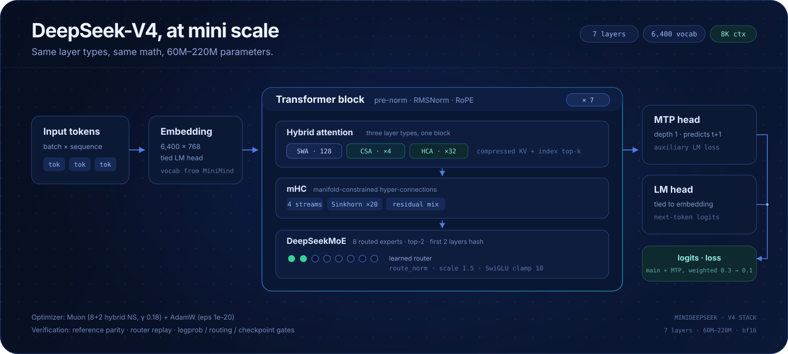
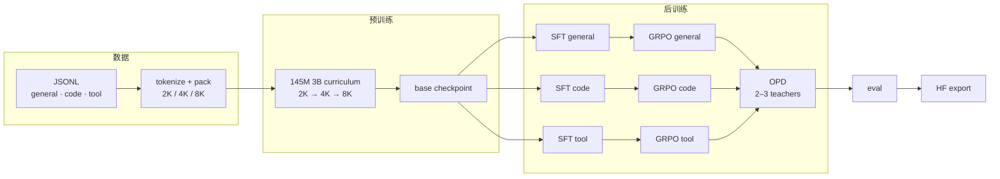

<div align="center">
  
</div>

<p align="center">
  <a href="https://www.python.org/"></a>
  <a href="https://pytorch.org/"></a>
  <a href="https://modelscope.cn/datasets/Alita0429/mini-deepseek"></a>
  <a href="#五分钟先跑起来"></a>
  <a href="LICENSE"></a>
  <a href="#现在跑到哪了"></a>
</p>

<h3 align="center">训练一个属于你自己的 baby DeepSeek</h3>

<p align="center">
  <b>60M–220M</b> · <b>DeepSeek-V4 同构</b> · <b>CPU 可验证</b> · <b>单卡可训</b>
</p>

DeepSeek 每一次更新，都会把一些原本只在大厂内部讨论的技术推到开源社区：MoE、CSA/HCA、
mHC、MTP、GRPO、多教师 OPD…… 但对大多数人来说，真正开始训练时，用的还是最普通的
dense Transformer / GPT-2 式堆叠。

不是不想用前沿技术，而是三件事挡在前面：论文里的配置动辄几百 B、1M context，个人根本跑不起；
把新结构从论文搬进能训练的代码，还要接数据、并行、RL、推理，工程量太大；更缺一套能告诉自己
“我真的跑对了”的测试和门禁。

**miniDeepSeek 想填的就是这个空。** 我们把 DeepSeek 的技术栈拆成可读的模块，缩到 60M–220M，
接上一条从预训练到 OPD 的完整链路。它不是“又一个 MiniGPT”，而是一个 **DeepSeek 技术栈的大杂烩**：
让你用很低的成本，亲手训练一个自己的 baby DeepSeek，或者只拆其中一块做实验。

> **一句话**：DeepSeek 负责把技术推到前沿，miniDeepSeek 负责把它拉回一张 24 GB 显卡。

> [!NOTE]
> 这是一个**研究方法复现 + 教学向**项目，不是产品，也不追 benchmark。
> 当前主跑的是 **145M MoE**；220M / 60M 用于结构对照与 1-step 验证。
> 代码按多卡 CUDA 设计，CPU 只负责逻辑验证。

**直接跳转**：[先跑起来](#五分钟先跑起来) · [硬核部分](#硬核部分) · [文档](#文档地图)

---

## 你可以得到什么

- 🧬 **一个真正同构的小模型**：SWA + CSA + HCA 混合注意力、mHC、DeepSeekMoE、MTP、
  SwiGLU clamp、Muon，不是只改小 `hidden_size`。
- 🔁 **一条能跑通的链路**：数据清洗 → 2K/4K/8K 预训练 → 三个 specialist 的 SFT → GRPO →
  多教师 OPD → eval / HF export。
- 🧪 **一套能验证的结果**：305 个 CPU 测试；router replay、logprob / routing / checkpoint
  一致性门禁；每个数字都对应仓库里的命令。
- 🧰 **一份能拆改的代码**：模型、数据、训练、RL、评估按职责分模块；想研究 MoE 路由、
  CSA/HCA、mHC、KV-cache rollout，都能单独拎出来。
- 📦 **开箱即用的数据**：3B 语料和预训练 tokenization 已发布在
  [ModelScope](https://modelscope.cn/datasets/Alita0429/mini-deepseek)，不用先花几个小时重新打包。

---

## 数据已发布

3B 语料和预训练 tokenization 已经传到 ModelScope：
**[Alita0429/mini-deepseek](https://modelscope.cn/datasets/Alita0429/mini-deepseek)**

| 文件 | 内容 |
|---|---|
| `packs.tar.zst` | 2K / 4K / 8K 的预训练 tokenization（train + val），约 3.4 GB 压缩，解压即用 |
| `*.jsonl` | pretrain / SFT / GRPO / OPD / eval 的平铺数据 |
| `SHA256SUMS` | 下载后校验 |

这是本仓库现在**最省事的数据入口**：不用自己跑 3B token 的 tokenize / pack，下载解压后直接进预训练。

## 五分钟先跑起来

不需要 GPU，也不需要数据。先确认代码逻辑是通的：

```bash
git clone https://github.com/Alita02384/miniDeepSeek.git
cd miniDeepSeek

# 安装，二选一
./scripts/setup_env.sh                 # 需要 uv；默认找 $HOME/.local/bin/uv
# 或者
python3.12 -m venv .venv
.venv/bin/pip install -e '.[dev]'

# 2-step 训练 smoke → 一致性门禁 → 全量 CPU 测试
./scripts/debug_smoke.sh
```

看到 `305 passed, 2 skipped` 就说明模型前向/反向、checkpoint、路由和测试都正常。
如果只是想确认“这个仓库能跑”，到这里就够了；想真正训练，继续看下一节。

> `setup_env.sh` 的 `uv` 不在默认路径时，用 `UV=/path/to/uv ./scripts/setup_env.sh`。

---

## 想训练自己的 baby DeepSeek？

这是训练版的 quick start：数据直接用 ModelScope 上已打包好的 tokenization，不重新 tokenize。

**数据（推荐直接用已打包好的）**：3B 语料与 tokenization 已发布在
[ModelScope](https://modelscope.cn/datasets/Alita0429/mini-deepseek)。下载 `packs.tar.zst`
并解压到仓库根目录即可：

```bash
# 预训练 tokenization（约 3.4 GB，支持断点续传）
curl -L --fail -C - -o packs.tar.zst \
  https://www.modelscope.cn/datasets/Alita0429/mini-deepseek/resolve/master/packs.tar.zst

# 先确认路径：应看到 data/tokenization/pretrain_*.npz
zstd -dc packs.tar.zst | tar -tf - | head -3

# 解压；在仓库根目录执行
zstd -dc packs.tar.zst | tar -xf -
rm packs.tar.zst
```

解压后 `data/tokenization/` 下是 `pretrain_{general,code,tool}_{2k,4k,8k}.npz` 和对应的
`val_*`，正好是 `train_curriculum.sh` 读取的格式。SFT / GRPO / OPD 的 JSONL 也在同一个
数据集仓库，按需下载到 `data/` 即可。

> 需要 `zstd`：macOS `brew install zstd`，Ubuntu `sudo apt install zstd`。
> 没有 ModelScope 网络时，仍可从 MiniMind 公开数据生成最小 JSONL
> （`MINIMIND_ROOT=../minimind/dataset bash scripts/build_data.sh`）。

**预训练**：按卡数自动拆 micro-batch / grad_accum，262k token/step 不变。

```bash
.venv/bin/python scripts/autoconfig_145m.py --gpus 2
NPROC_PER_NODE=2 bash scripts/train_curriculum.sh \
  configs/pretrain/generated/curriculum_145m_g2.yaml
```

**后训练**：把 `configs/sft/*.yaml` 里的 `train.resume` 指向你的预训练 checkpoint，然后：

```bash
for spec in general code tool; do
  bash scripts/train_sft.sh  configs/sft/$spec.yaml
  bash scripts/train_grpo.sh configs/grpo/$spec.yaml
done
bash scripts/train_opd.sh configs/opd/three_teacher.yaml
```

显存、迁移、断点续训的完整步骤在 [`doc/run_145m_gpuhome.md`](doc/run_145m_gpuhome.md)
和 [`doc/posttraining_plan.md`](doc/posttraining_plan.md)。只想跑 SFT/GRPO 的话，
单卡 4090 就够。

---

## 现在跑到哪了

> 截至 **2026-11-11**。这里只写实际跑过的；未验证项在[边界与未完成](#边界与未完成)。

- ✅ **代码 / 测试**：`305 passed, 2 skipped`（CPU，debugmodel，约 72 s）
- 🔄 **145M 预训练**：2K 阶段 step 1200 / 1717；val loss 2.456 / ppl 6.3 @ step 1199
- ✅ **general SFT + GRPO**：120 step / 50 step；单卡 4090 上 6–7k tok/s、18.6 s/step
- ✅ **code / tool SFT**：已产出 final；GRPO code / tool 只跑了 2-step smoke
- ✅ **3-teacher OPD**：20 step 跑通并落盘，KL total mean 0.065（general 0.041 / code 0.052 / tool 0.100），约 17 s/step
- ⏳ **220M / 60M 实跑**：当前只做结构、参数量与 1-step 验证；主跑是 145M

详细数字见下面的[实测表](#实测数字)。

---

## 硬核部分

第一次来可以跳过；想复现、改代码、对照实现时再回来。

### 模型矩阵

| 模型 | 总参 / 激活 | 层 | FFN | 专家路由 | 用途 |
|---|---:|---:|---|---|---|
| `mini_60m_dense_d768` | 60.88M / 60.88M | 7 | 1 dense expert | — | dense 对照 |
| `mini_145m_a60m` | 145.84M / 60.91M | 7 | 6 routed experts | top-2 | **当前主跑** |
| `mini_220m_a80m` | 216.65M / 82.17M | 7 | 8 routed experts | top-2 | 默认训练模型 / 最大档 |
| `debugmodel` | 12.98M（含 MTP） | 4 | 4 routed experts | top-3 | CPU 测试 / 参考对齐 |

三档目标模型共享：`SWA + CSA(×4) + HCA(×32)` 混合注意力、mHC、MTP depth 1、
tied embeddings、6,400 词表、`max_context=8192`。模型结构文件在
[`configs/model/`](configs/model/)，参数量与配置依据见
[`doc/Parameter_Setting.md`](doc/Parameter_Setting.md)。

### 架构：和 V4 同构

<div align="center">
  
</div>

核心不是“层数一样”，而是每个组件的**计算方式**与 V4 对齐：注意力是 SWA + CSA + HCA 的
混合层型，mHC 走 Sinkhorn 混合，MoE 有 hash routing / loss-free bias，MTP 是 depth 1
的辅助头，优化器是 Muon + AdamW。

<details>
<summary><b>展开：V4 组件对照表</b></summary>

| V4 组件 | 本项目实现 | 怎么验证 |
|---|---|---|
| 混合注意力 | SWA（window 128）+ CSA（压缩率 4）+ HCA（压缩率 32），三种层型交替 | 与参考实现逐层数值对齐；indexer top-k 边界测试 |
| mHC | 4 条流、Sinkhorn ×20、残差混合 | forward / backward / MTP 梯度 |
| DeepSeekMoE | routed experts + top-k、前 2 层 hash routing、`route_norm` / `route_scale` | router 录制/回放、专家负载、路由熵 |
| MTP | depth 1 的辅助 LM head，loss 权重 0.3 → 0.1 | logits / loss / backward |
| SwiGLU clamp | `swiglu_limit=10.0` 常开 | gate/up clamp 计数与比例 |
| 优化器 | Muon（8+2 hybrid NS，γ=0.18）+ AdamW（eps=1e-20） | 单步更新数值测试 |
| CSA indexer 蒸馏 | indexer 辅助 KL loss，eval 时关闭 | loss 有限、indexer 有梯度 |
| Anticipatory Routing | 一步预取队列 + 当前 gate 缓存 routing | 预取队列 / 回放测试，默认关闭 |

实现按职责拆在 [`src/minideepseek/model/`](src/minideepseek/model/)，来源、commit
与改动记录在 [`doc/sources.md`](doc/sources.md)。state dict 的 key 和形状与参考实现一致，
可以直接对照加载。

</details>

### 训练流水线



| 阶段 | 做什么 | 入口 | 产物 |
|---|---|---|---|
| 数据 | 清洗、去重、配比、2K/4K/8K 打包 | `scripts/build_pretrain_packs.sh` | `data/tokenization/*.npz` |
| 预训练 | 3B token 长度课程，262,144 token/step | `scripts/train_curriculum.sh` | `checkpoints/curriculum_145m_3b/` |
| SFT | general / code / tool 三个 specialist | `scripts/train_sft.sh` | `checkpoints/sft_*_145m/final` |
| GRPO | 可验证 reward / 1.8B reward model / tool reward | `scripts/train_grpo.sh` | `checkpoints/grpo_*_145m/final` |
| OPD | student 采样，多 teacher full-vocab reverse KL | `scripts/train_opd.sh` | `checkpoints/opd_three_teacher_145m/final` |
| 评估/导出 | 领域 rubric、可选 lm-eval、HF 格式 | `scripts/eval.sh` / `scripts/export_hf.py` | 报告 / `hf/` |

`configs/pipeline/` 下有一个薄编排器，会按实际 token 数计算 step、检查 prereq，
并跳过已经产出 `final/` 的 stage。它是 **145M 模板**，不是当前 3B 分域 pack 的
唯一入口：3B 预训练以 `train_curriculum.sh` 为准，后训练以 `scripts/train_sft.sh`
/ `train_grpo.sh` / `train_opd.sh` + 单阶段 config 为准。pipeline 的
`--dry-run` 现在会对缺失的 data/resume/teacher checkpoint 直接失败。

### 实测数字

| 项目 | 数值 | 条件 |
|---|---:|---|
| 预训练吞吐 | **29,580 tok/s** / 8.86 s/step | 2×4090D，DDP，2K stage，bf16，12.8 GiB / 卡 |
| SFT 吞吐 | 6.1–7.0k tok/s | 1×4090，4K，micro 8192，grad_accum 16，12.7 GiB |
| GRPO step | 18.6 s | 1×4090，16 prompt × group 6 × 512 token，9.0 GiB |
| KV-cache decode | 5.4 ms/step ≈ 12k tok/s | 1×4090，batch 64，CUDA graph |
| 3-teacher OPD | KL total 0.065 / 20 step | 9,135 prompt pool，general/code/tool teacher，约 17 s/step |
| 一致性门禁 | logprob / routing / checkpoint 三类 | CPU debugmodel + 2 进程 DDP |

> 预训练当前还在 2K 阶段，4K / 8K 与完整 3B 尚未跑完；表里不混计划值。
> 逐项审计见 [`doc/roadmap_audit.md`](doc/roadmap_audit.md)，优化 A/B 见
> [`doc/optimization_2026-11-10.md`](doc/optimization_2026-11-10.md)。

---

## 目录结构

```text
miniDeepSeek/
├── src/minideepseek/
│   ├── model/        # V4 同构模型、attention/compressor、mHC、MoE、MTP、KV cache、routing
│   ├── data/         # 平铺 JSONL、tokenize/pack、去重、污染检查、manifest、混料
│   ├── train/        # Muon+AdamW、curriculum、scheduler、metrics、trainer
│   ├── rl/           # rollout、GRPO、多教师 OPD、reward model、tool / agent rollout
│   ├── consistency/  # logprob / routing / checkpoint 一致性门禁
│   ├── eval/         # general / code / tool / math 评估
│   └── viz/          # 自包含 report.html（内联 SVG 图表）
├── configs/          # model / pretrain / sft / grpo / opd / eval
├── scripts/          # 环境、数据、训练、监控、benchmark、导出
├── tests/            # 305 个 CPU 测试，全部使用 debugmodel
├── tokenizer/        # MiniMind 6,400 tokenizer + chat template
├── doc/              # 设计决策、代码来源、开发日志、复现 runbook
├── assets/           # logo / banner / 架构图
├── data/             # 本地数据（git 忽略，仅 manifests 入库）
└── checkpoints/      # 训练产物（git 忽略）
```

---

## 边界与未完成

- **预训练尚未跑完 3B。** 145M 当前在 2K 阶段 step 1200 / 1717；4K / 8K 阶段和完整
  3B token 仍在计划中。上面所有数字都标了对应 stage，不把计划值当结果。
- **220M / 60M 还没有真实训练。** 它们目前用于结构、参数量的对照和 1-step 验证。
- **没有 EP（专家并行）。** 145M 用 DDP；FSDP2 路径存在，但在 145M 上比 DDP 慢
  （见 D81）。EP 的 all-to-all dispatch 未实现。
- **vLLM 不能直接服务这个模型。** 4090 是 SM89、模型 `head_dim=64`，不满足 vLLM 的
  FlashMLA / FlashInfer 后端要求；rollout 走项目内自研 KV-cache + CUDA graph 引擎。
  prefill 仍是 torch reference，尚未做 chunked prefill。
- **3-teacher OPD 只跑了 20 step。** KL 在 0.055–0.085 间波动、没有单调下降，
  lr / 步数还没扫；code / tool teacher 仍是 SFT，GRPO 只有 smoke，teacher 上限受限。
- **tool 多轮 rollout 已接 cached continuation**，但 FSDP2 + cached 还没接；
  prefill 仍是 torch reference，chunked prefill 未做。
- **长上下文不在当前范围。** `max_context=8192`，没有 1M context、FP8/FP4、
  DSpark / 推测解码。
- **Anticipatory Routing 默认关闭**；已实现预取队列，但 probe 仍是同步执行。
- **数据规模到 6B 时需要分布式去重**；当前去重 / 污染检查是单进程实现。

---

## 文档地图

| 想了解 | 读这个 |
|---|---|
| 为什么这么设计、哪里偏离了原计划 | [`doc/decisions.md`](doc/decisions.md) |
| 哪些代码来自上游、改了什么 | [`doc/sources.md`](doc/sources.md) |
| 每个阶段的开发日志与验证命令 | [`doc/PROCESS.md`](doc/PROCESS.md) |
| 测试策略与一致性门禁 | [`doc/testing.md`](doc/testing.md) |
| 下载数据 / 看文件清单 | [ModelScope 数据集](https://modelscope.cn/datasets/Alita0429/mini-deepseek) |
| 3B 数据来源、配比、license | [`doc/data_plan_145m.md`](doc/data_plan_145m.md)、[`doc/external_data.md`](doc/external_data.md) |
| 145M 上线、迁移、packs 传输 | [`doc/run_145m_gpuhome.md`](doc/run_145m_gpuhome.md)、[`doc/server_runbook.md`](doc/server_runbook.md) |
| SFT / GRPO / OPD 的后训练细节 | [`doc/posttraining_plan.md`](doc/posttraining_plan.md) |
| 显存、吞吐、batching 预算 | [`doc/hardware_budget.md`](doc/hardware_budget.md)、[`doc/batching.md`](doc/batching.md) |
| 实现审计：哪些只是代码落地 | [`doc/roadmap_audit.md`](doc/roadmap_audit.md) |

---

## 致谢

模型结构与训练方法来自 **DeepSeek-V4** 技术报告；参考实现与工程经验来自
[torchtitan](https://github.com/pytorch/torchtitan)、
[verl](https://github.com/volcengine/verl) 和
[MiniMind](https://github.com/jingyaogong/minimind)。
本项目把需要的部分**复制并重构**进自己的模块，保留版权头并在
[`doc/sources.md`](doc/sources.md) 记录来源；运行时**不依赖**这些仓库。
README 的视觉风格参考 MiniMind 的轻量、手绘感表达。

Tokenizer 与基础数据来自 MiniMind；外部语料各自带有 license，见
[`doc/external_data.md`](doc/external_data.md)。

## License

代码以 [MIT License](LICENSE) 发布。数据、tokenizer 与第三方模型的 license 独立于代码，
使用前请阅读对应的 manifest 与数据说明。

> DeepSeek 名称与蓝鲸标识归 DeepSeek 所有。README 里的蓝鲸标识是对其的非官方致敬，
> 不代表 DeepSeek 官方；标识字体为 Fredoka / DM Serif Display（SIL OFL），已转为路径，
> 详见 [`assets/README.md`](assets/README.md)。

---

<div align="center">
  <sub>如果这个项目对你有帮助，欢迎 Star ⭐ / 提 Issue / 发 PR。</sub><br>
  <sub>在提交 PR 前，请先跑一遍 <code>./scripts/debug_smoke.sh</code>。</sub>
</div>
