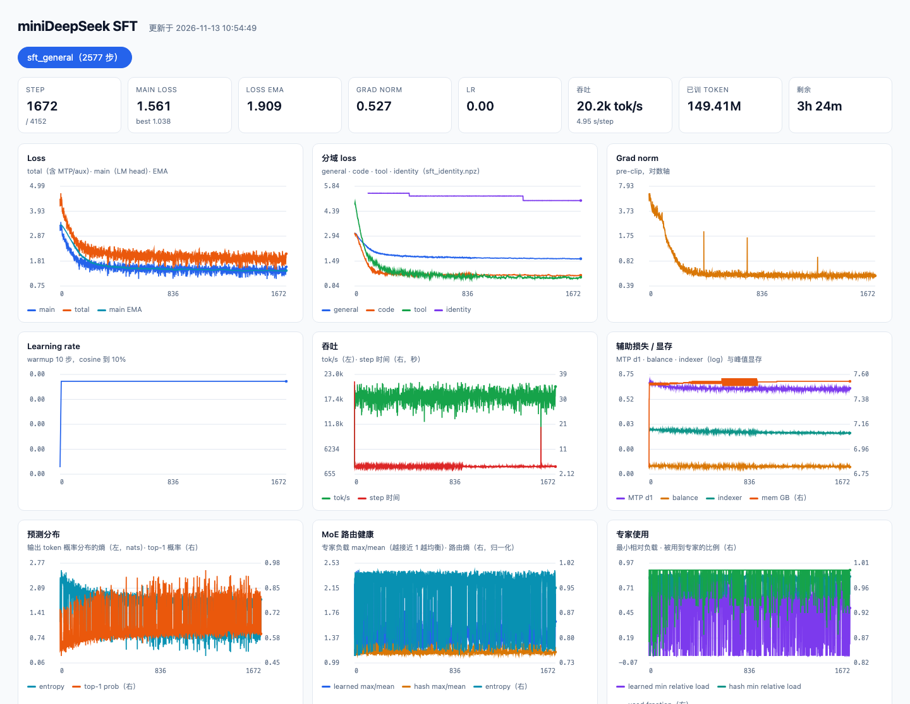
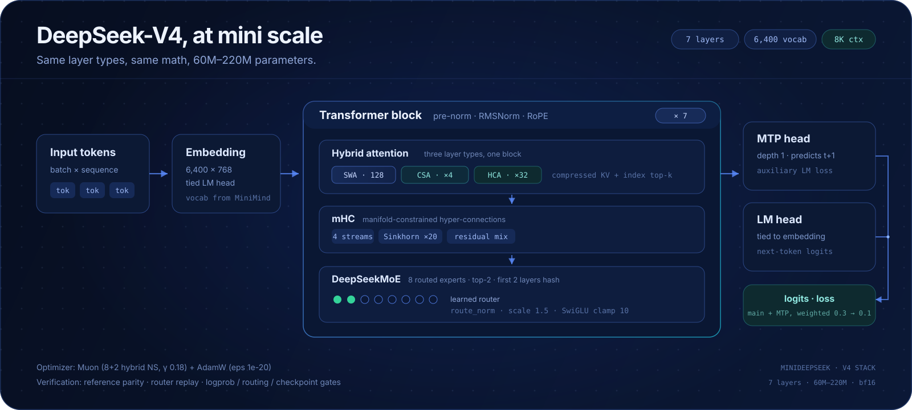

<div align="center">
  
</div>
<div align="center">


[](https://github.com/Alita02384/miniDeepSeek/stargazers)
[](LICENSE)
[](https://github.com/Alita02384/miniDeepSeek/commits)
[](https://github.com/Alita02384/miniDeepSeek/pulls)

</div>

<h3 align="center">从0开始，训练一个属于你自己的 baby DeepSeek</h3>

<p align="center">
  <a href="https://modelscope.cn/datasets/Alita0429/mini-deepseek"><b>🤗 开源数据集</b></a> ·
  <a href="https://modelscope.cn/models/Alita0429/miniDeepSeek/files"><b>🤗 模型权重</b></a> ·
  <a href="#-训练报告">📊 训练报告</a> ·
  <a href="#-快速开始">🚀 快速开始</a>
</p>

<p align="center">
  <b>145M 参数</b> · <b>DeepSeek-V4 同构</b> · <b>消费级 GPU 训练</b>
</p>

---

# 📌 项目介绍

**miniDeepSeek 是一个面向大模型初学者的开源训练项目：用消费级显卡，从零训练一个 145M 参数的小型 DeepSeek，学习从预训练到强化学习与多教师蒸馏的完整过程。**

想自己训练大模型，常常会遇到一道门槛：nanoGPT、MiniMind 等入门项目容易上手，但主要围绕经典的稠密 Transformer；想进一步学习 MoE、压缩注意力和复杂的后训练流程，又往往需要面对面向集群的框架和较高的工程门槛。**miniDeepSeek 希望补上这段学习路径，让初学者也能读懂、运行和修改 DeepSeek 的核心结构与训练方法。**

项目将 DeepSeek-V4 的核心组件缩小到 **145.84M 总参数、60.91M 激活参数**，提供自包含的模型代码、训练脚本、开源数据和训练报告。预训练已在 **2×24GB RTX 4090D** 上完成，SFT / GRPO / OPD 支持单张 24GB RTX 4090。你可以先在 CPU 上运行小模型测试，再用 GPU 逐步实践下面的训练路线：

```text
从零预训练 → 通用 / 代码 / 工具调用三个领域模型的 SFT
           → 各领域模型的 GRPO 强化学习 → 多教师 OPD 蒸馏为统一模型
```

这里的三个领域模型都是从同一个预训练模型出发、分别训练的完整模型。项目的目标是让你亲手理解这些方法如何协同工作，并通过训练曲线与评估检查效果；各阶段的实际完成情况见下方「当前进度」。

## 你可以在这里学到什么

- **模型怎么搭**：理解 DeepSeekMoE、CSA/HCA 混合注意力、mHC 和 MTP 在小模型中的实现。
- **模型怎么训**：从数据准备、2K → 4K → 8K 预训练，到指令微调、GRPO 和多教师 OPD，逐步运行训练脚本。
- **训练效果怎么看**：观察 loss、分域表现和专家路由，检查 checkpoint 与生成过程的一致性，定位训练中的问题。

## 📝 当前进度

- ✅ **代码 / 测试**：CPU 全量通过；`debugmodel`（12.98M，仅测试用）覆盖 forward/backward、checkpoint、routing、cache、rollout。
- ✅ **145M 预训练**：2K → 4K → 8K 全程 **11,444 步 / 2.68B token**；val main loss **1.1407**、ppl **2.755**，路由熵 1.77 / 2.08 nats。
- 🔄 **145M SFT**：三域数据全量 tokenize（general 359M / code 25M / tool 7M target，各 1 epoch）；跑到 step 1672 / 4152 时因机器停机暂停，恢复后自动续训。
- ⏳ **GRPO / OPD**：旧版 4K 链已跑通但结果不可用（code 单测通过率恒 0、tool 轨迹 97% 截断，已定位为 tokenizer 停止符与 SFT 停止行为问题）；新版 SFT 完成后重跑。

---

# 📊 训练报告

下面是仓库中已保存的训练看板截图，展示主要曲线；点击图片可打开完整交互式报告。截图是历史记录，不代表实时训练状态。

## 预训练：2K → 4K → 8K

预训练已完成 **11,444 步，实际消费约 2.68B token**。看板记录到 step 11,440，可查看训练 loss、分域验证结果、专家负载与路由变化。

[](https://raw.githack.com/Alita02384/miniDeepSeek/main/reports/curriculum_145m_3b_dashboard.html)

[打开完整预训练报告](https://raw.githack.com/Alita02384/miniDeepSeek/main/reports/curriculum_145m_3b_dashboard.html) · [查看 HTML 文件](reports/curriculum_145m_3b_dashboard.html)

## SFT：指令微调阶段记录

以下截图来自 **2026-11-13 保存的 general SFT 看板**，显示 step **1,672 / 4,152** 时的训练指标，包括 loss、分域 loss、梯度、吞吐与路由情况。这是阶段性记录，尚非三个领域模型全部训练完成的报告。

[](https://raw.githack.com/Alita02384/miniDeepSeek/main/reports/sft_dashboard.html)

[打开完整 SFT 报告](https://raw.githack.com/Alita02384/miniDeepSeek/main/reports/sft_dashboard.html) · [查看 HTML 文件](reports/sft_dashboard.html)

<details>
<summary>导出自己的训练报告</summary>

先用 `scripts/merge_metrics.py` 合并预训练各阶段的 metrics，再导出看板：

```bash
# 预训练
python3 scripts/live_dashboard.py --export pretrain_report.html --local-metrics metrics_full.jsonl

# SFT
python3 scripts/sft_dashboard.py --export sft_report.html --total-steps 4152
```

</details>

---

# 📌 快速开始

## 第0步

```bash
# 克隆仓库、安装依赖
git clone https://github.com/Alita02384/miniDeepSeek.git
cd miniDeepSeek
python3.12 -m venv .venv
.venv/bin/pip install -e '.[dev]'
```

不需要 GPU，也不需要数据。先验证代码环境不报错：

```bash
# 2-step 训练 smoke → 一致性门禁 → 全量 CPU 测试
./scripts/debug_smoke.sh
```

看到 `365 passed, 2 skipped` 就说明模型前向/反向、checkpoint、路由和测试都正常。
如果只是想确认“这个仓库能跑”，到这里就够了；想真正训练，继续看下一节。

## Ⅰ 🛠️ 模型训练

<details>
<summary>注：提前确认 Torch 的可用后端</summary>

```python
import torch
print(torch.cuda.is_available())
```

项目按**多卡 CUDA**设计，最终训练以 CUDA 为准；CPU / MPS 只用于跑通逻辑与 debug 模型。
如需安装或更换 PyTorch 版本，可参考 [torch_stable](https://download.pytorch.org/whl/torch_stable.html)。

</details>

### 1' 下载数据

3B 语料与 2K/4K/8K tokenization 已打包发布，不用自己重新 tokenize：

```bash
# 预训练 tokenization（约 3.4 GB，支持断点续传）
curl -L --fail -C - -o packs.tar.zst \
  https://www.modelscope.cn/datasets/Alita0429/mini-deepseek/resolve/master/packs.tar.zst

# 先确认路径：应看到 data/tokenization/pretrain_*.npz
zstd -dc packs.tar.zst | tar -tf - | head -3

# 解压；在仓库根目录执行
zstd -dc packs.tar.zst | tar -xf -
rm packs.tar.zst
```

解压后 `data/tokenization/` 下是 `pretrain_{general,code,tool}_{2k,4k,8k}.npz` 和对应的 `val_*`，
正好是 `train_curriculum.sh` 读取的格式。SFT / GRPO / OPD 的 JSONL 也在同一个数据集仓库，
按需下载到 `data/` 即可。

> 需要 `zstd`：macOS `brew install zstd`，Ubuntu `sudo apt install zstd`。
> 没有 ModelScope 网络时，仍可从 MiniMind 公开数据生成最小 JSONL：
> `MINIMIND_ROOT=../minimind/dataset bash scripts/build_data.sh`。

### 2' 开始训练

<details>
<summary>💡 检查点暂停续训</summary>

所有阶段都支持断点续训，由 config 控制：

- `train.auto_resume: true`：自动从 `out_dir` 里最新的 checkpoint 恢复；
- `train.resume: <path>`：显式指定恢复的 base；
- `out_dir/final` 已存在且 resume 指向外部 base 时，启动前会直接报错，避免误覆盖。

检查点包含模型、优化器与训练进度；支持跨不同 GPU 数量恢复（按全局 token 数换算 step）。

</details>

#### 2.1 预训练（必须）

按卡数自动拆 micro-batch / grad_accum，262,144 token/step 不变：

```bash
.venv/bin/python scripts/autoconfig_145m.py --gpus 2
NPROC_PER_NODE=2 bash scripts/train_curriculum.sh \
  configs/pretrain/generated/curriculum_145m_g2.yaml
```

> 训练后，将得到 `checkpoints/curriculum_145m_3b/stage_*_seq*/final/` 作为输出权重。

#### 2.2 指令微调（必须）

把 `configs/sft/*.yaml` 里的 `train.resume` 指向你的预训练 checkpoint，然后：

```bash
for spec in general code tool; do
  bash scripts/train_sft.sh configs/sft/$spec.yaml
done
```

> 训练后，将得到 `checkpoints/sft_{general,code,tool}_145m/final/`。response-only mask，MTP loss 0.3 → 0.1。

#### 2.3 GRPO（可选）

```bash
for spec in general code tool; do
  bash scripts/train_grpo.sh configs/grpo/$spec.yaml
done
```

> general 用 1.8B reward model，code 用单元测试，tool 用 tool-call reward；
> 产物在 `checkpoints/grpo_{general,code,tool}_145m/final/`。
> general 需要先把 `internlm2-1_8b-reward` 放到仓库根目录（约 3.2 GB，下载见
> [`doc/server_runbook.md`](doc/server_runbook.md)）。

#### 2.4 多教师 OPD（可选）

```bash
bash scripts/train_opd.sh configs/opd/three_teacher.yaml
```

> student 自己采样，general / code / tool 三个 teacher 对同一轨迹算 full-vocabulary reverse KL，权重各 1/3。

#### 2.5 测试已训练模型（可选）

```bash
bash scripts/eval.sh configs/eval/general.yaml
bash scripts/eval.sh configs/eval/code.yaml
bash scripts/eval.sh configs/eval/tool.yaml
```

> 产物是 JSON / markdown 报告；`configs/eval/*.yaml` 里可以改 checkpoint、样本数与 rubric。

## Ⅱ 📦 模型导出

```bash
.venv/bin/python scripts/export_hf.py \
  --checkpoint checkpoints/sft_general_145m/final \
  --out hf/mini_145m_a60m --flavor mini_145m_a60m
```

导出目录可用 `trust_remote_code=True` 加载，供 transformers / verl / vLLM 使用。

---

# 📌 数据介绍

## Ⅰ Tokenizer

沿用 MiniMind 的 **6,400** 词表 BPE tokenizer（[`tokenizer/`](tokenizer/)），含 ChatML 模板。
6,400 词表让 tied embedding 只占约 4.9M 参数，也是 OPD 做全词表 reverse KL、
GRPO 算全词表 logprob 的前提。**不要换词表**——换一次就要重训全部权重，并同步改所有 pack。

## Ⅱ Pretrain 数据

预算 3B token（实跑 **2.68B**：按 262,144 token/step × 11,444 步的预算，pack 填充率 76–95%，实际消费略低于预算），按 **general / code / tool = 82% / 15% / 3%** 混料，2K → 4K → 8K 三段互不重叠：

| 阶段 | token | 序列长度 |
|---|---:|---:|
| 2K | 0.450B | 2048 |
| 4K | 1.650B | 4096 |
| 8K | 0.900B | 8192 |

来源：MiniMind `pretrain_t2t`、fineweb-edu、chinese-fineweb-edu、cosmopedia-v2、finemath、
codeparrot-clean，以及 ToolACE / glaive 的 schema→call 文本。跨源精确去重后按预算哈希裁剪，
并对评测集做 13-gram 污染检查。

```jsonl
{"text": "Transformer 通过自注意力机制建模上下文关系，是现代大语言模型的重要基础结构。"}
```

## Ⅲ SFT 数据

三个 specialist 各自一套数据，response-only mask，领域数据 70–90% + general 10–30%：

| 专家 | 文档数 | loss token | 1 epoch 步数 |
|---|---:|---:|---:|
| general | 877,651 | 359.1M | 4,152 |
| code | 148,723 | 24.5M | 480 |
| tool | 99,552 | 6.9M | 285 |
| identity | 69 | 2.2k | 混入 general（权重 0.0002） |

三个域都是 **1 个 target epoch**（`configs/pipeline/posttrain_e2e_145m.yaml`），
identity 以 0.0002 的权重混进 general，约 15 遍，用来修正「你是谁」的自述。

MiniMind 语料里的旧身份（`jingyaogong / minimind / 小参数AI模型`）已用
[`scripts/scrub_identity.py`](scripts/scrub_identity.py) 清掉，并换成本项目身份。

```jsonl
{"conversations": [{"role": "user", "content": "你好"}, {"role": "assistant", "content": "你好！"}]}
```

## Ⅳ RL 数据

- **GRPO general**：`data/grpo_general_train.jsonl`（17,460 prompt），1.8B reward model + 长度/思考/重复惩罚。
- **GRPO code**：MBPP + open-r1 过滤后的可执行题，单元测试 + 编译/格式加权。
- **GRPO tool**：`data/grpo_tool_train.jsonl`（33,960 prompt），tool-call / 参数正确性 reward。
- **OPD**：9,135 prompt 池，general / code / tool 三个 teacher，full-vocab reverse KL。

```jsonl
{"prompt": "写一个函数计算列表均值", "reference_answer": "def mean(xs): ...", "rubric": "unit_test"}
```

## Ⅴ 训练数据集

训练数据已开源，无需自行预处理：[ModelScope](https://modelscope.cn/datasets/Alita0429/mini-deepseek)

```text
packs.tar.zst      # 2K/4K/8K 预训练 tokenization（train + val），约 3.4 GB 压缩
*.jsonl            # pretrain / SFT / GRPO / OPD / eval 的平铺数据
SHA256SUMS         # 下载后校验
```

---

# 📌 模型

## 结构

每个组件的**计算方式**与 V4 对齐，而不只是“层数一样”：

- **混合注意力**：7 层按 `(0, 0, 4, 32, 4, 32, 4)` 排列，SWA window 128、CSA 压缩率 4、HCA 压缩率 32；CSA indexer top-k 1024@4K / 2048@8K。
- **mHC**：4 条 residual stream，Sinkhorn ×20 混合。
- **DeepSeekMoE**：前 2 层 token-id hash routing，其余 top-k 学习路由；`route_norm` + `route_scale=1.5`，loss-free 负载均衡 bias。
- **MTP**：depth 1 辅助 LM head，loss 权重 0.3 → 0.1。
- **其它**：SwiGLU clamp 10.0、MLA（q/o LoRA rank 288）、tied embeddings、Muon + AdamW。

<div align="center">
  
</div>

实现按职责拆在 [`src/minideepseek/model/`](src/minideepseek/model/)，来源、commit 与改动记录在
[`doc/sources.md`](doc/sources.md)。state dict 的 key 和形状与参考实现一致，可以直接对照加载。

## 模型配置

| 模型 | 总参 / 激活 | 层 | FFN | 路由 | 用途 |
|---|---:|---:|---|---|---|
| `mini_145m_a60m` | 145.84M / 60.91M | 7 | 6 routed experts | top-2 | **当前主跑** |

配置：`dim=768`、7 层 + 1 层 MTP、`n_heads=12 / head_dim=64`、`vocab=6400`、`seq_len=4096`、
`max_context=8192`、`swiglu_limit=10.0`、`hc_mult=4`、`sinkhorn_iters=20`。
完整字段见 [`configs/model/mini_145m_a60m.yaml`](configs/model/mini_145m_a60m.yaml) 与
[`doc/Parameter_Setting.md`](doc/Parameter_Setting.md)。CPU 测试另用 `debugmodel`（12.98M）。

---

# 📌 实验

## Ⅰ 训练开销

实测环境：2×4090D 或 1×4090 24GB，bf16：

| 项目 | 数值 | 条件 |
|---|---:|---|
| 预训练吞吐 | **19.1–19.6k tok/s** / 13.4 s/step | 2×4090D，DDP，8K stage，262,144 token/step |
| 预训练吞吐（2K） | 29,580 tok/s / 8.86 s/step | 2×4090D，DDP，2K stage，12.8 GiB / 卡 |
| SFT 吞吐 | 18–20k tok/s | 2×4090D，DDP，4K，micro 8192×2，grad_accum 16，7.5 GiB |
| GRPO step | 18.6 s | 1×4090，16 prompt × group 6 × 512 token，9.0 GiB |
| KV-cache decode | 5.4 ms/step ≈ 12k tok/s | 1×4090，batch 64，CUDA graph |
| 3-teacher OPD | KL total 0.065 / 20 step | 9,135 prompt 池，约 17 s/step |

> 预训练已跑完 2K → 8K 全程（11,444 步，2.68B token）；表里都是实测值，不混计划值。

## Ⅱ 主要训练

| 阶段 | 配置 | 预算 | 产物 |
|---|---|---|---|
| 预训练 | `configs/pretrain/curriculum_145m_4x4090.yaml` | 11,444 步 / 2.68B token（预算 3B） | `checkpoints/curriculum_145m_3b/` |
| SFT | `configs/pipeline/posttrain_e2e_145m.yaml` | 4,152 / 480 / 285 步（各 1 epoch，357M target） | `checkpoints/posttrain_e2e_145m/sft_*/final/` |
| GRPO | `configs/pipeline/posttrain_e2e_145m.yaml` | 200 / 200 / 400 步 | `checkpoints/posttrain_e2e_145m/grpo_*/final/` |
| OPD | `configs/pipeline/posttrain_e2e_145m.yaml` | 100 步 | `checkpoints/posttrain_e2e_145m/opd_three_teacher/final/` |

## Ⅲ 其它训练

- **GRPO**：group 6、16 prompts/step、max_new 512、temperature 0.8、CISPO clip 0.2、KL 0；
  `rollout_backend=cached`。old logprob 由 actor 重算，ratio 从 1 开始（等价 on-policy REINFORCE + group baseline）。
- **OPD**：student 采样，三个 teacher 走 full-vocabulary reverse KL；loss 分母固定为 `Σw_i`，
  某步缺 teacher 不会放大剩余权重。
- **一致性门禁**：logprob / routing / checkpoint 三类检查，CPU debugmodel + 2 进程 DDP 覆盖。

---

# 📌 评估

## Ⅰ 领域评估

```bash
bash scripts/eval.sh configs/eval/general.yaml
bash scripts/eval.sh configs/eval/code.yaml
bash scripts/eval.sh configs/eval/tool.yaml
```

general 走 1.8B reward model，code 跑单元测试与语法惩罚，tool 检查调用格式与参数。
评估集与训练集做过 13-gram 污染检查。

## Ⅱ lm-eval（可选）

导出 HF 格式后，可接 [lm-evaluation-harness](https://github.com/EleutherAI/lm-evaluation-harness)：

```bash
.venv/bin/pip install -e '.[eval]'
.venv/bin/python scripts/run_lm_eval.py \
  --hf-model hf/mini_145m_a60m --tasks mmlu,arc_easy --limit 100
```

> 这类选择题对 145M 模型的分辨率有限；分数只作参考，不作为项目目标。

---

# 📌 其他

## 📁 目录结构

```text
miniDeepSeek/
├── src/minideepseek/
│   ├── model/        # V4 同构模型、attention/compressor、mHC、MoE、MTP、KV cache、routing
│   ├── data/         # JSONL、tokenize/pack、去重、污染检查、manifest、混料
│   ├── train/        # Muon+AdamW、curriculum、scheduler、metrics、trainer
│   ├── rl/           # rollout、GRPO、多教师 OPD、reward model、tool / agent rollout
│   ├── consistency/  # logprob / routing / checkpoint 一致性门禁
│   ├── eval/         # general / code / tool / math 评估
│   └── viz/          # 自包含 report.html（内联 SVG 图表）
├── configs/          # model / pretrain / sft / grpo / opd / eval
├── scripts/          # 环境、数据、训练、监控、benchmark、导出
├── tests/            # CPU 测试，全部使用 debugmodel
├── tokenizer/        # MiniMind 6,400 tokenizer + chat template
├── doc/              # 设计决策、代码来源、开发日志、复现 runbook
└── assets/           # logo / banner / 架构图
```

## 📚 文档地图

| 想了解 | 读这个 |
|---|---|
| 为什么这么设计、哪里偏离了原计划 | [`doc/decisions.md`](doc/decisions.md) |
| 哪些代码来自上游、改了什么 | [`doc/sources.md`](doc/sources.md) |
| 每个阶段的开发日志与验证命令 | [`doc/PROCESS.md`](doc/PROCESS.md) |
| 测试策略与一致性门禁 | [`doc/testing.md`](doc/testing.md) |
| 3B 数据来源、配比、license | [`doc/data_plan_145m.md`](doc/data_plan_145m.md)、[`doc/external_data.md`](doc/external_data.md) |
| 145M 上线、迁移、packs 传输 | [`doc/run_145m_gpuhome.md`](doc/run_145m_gpuhome.md)、[`doc/server_runbook.md`](doc/server_runbook.md) |
| SFT / GRPO / OPD 的后训练细节 | [`doc/posttraining_plan.md`](doc/posttraining_plan.md) |
| 显存、吞吐、batching 预算 | [`doc/hardware_budget.md`](doc/hardware_budget.md)、[`doc/batching.md`](doc/batching.md) |
| 实现审计：哪些只是代码落地 | [`doc/roadmap_audit.md`](doc/roadmap_audit.md) |

---

# 📌 致谢

模型结构与训练方法来自 **DeepSeek-V4** 技术报告；参考实现与工程经验来自
[torchtitan](https://github.com/pytorch/torchtitan)、
[verl](https://github.com/volcengine/verl) 和
[MiniMind](https://github.com/jingyaogong/minimind)。
本项目把需要的部分**复制并重构**进自己的模块，保留版权头并在
[`doc/sources.md`](doc/sources.md) 记录来源；运行时**不依赖**这些仓库。
README 的视觉与章节风格参考 MiniMind。

Tokenizer 与基础数据来自 MiniMind；外部语料各自带有 license，见
[`doc/external_data.md`](doc/external_data.md)。

## License

代码、数据、模型均以 [MIT License](LICENSE) 发布。

> DeepSeek 名称与蓝鲸标识归 DeepSeek 所有。README 里的蓝鲸标识是对其的非官方致敬，
> 不代表 DeepSeek 官方；标识字体为 Fredoka / DM Serif Display（SIL OFL），已转为路径，
> 详见 [`assets/README.md`](assets/README.md)。

---

<div align="center">
  <sub>如果这个项目对你有帮助，欢迎 Star ⭐ / 提 Issue / 发 PR。</sub><br>
</div>
