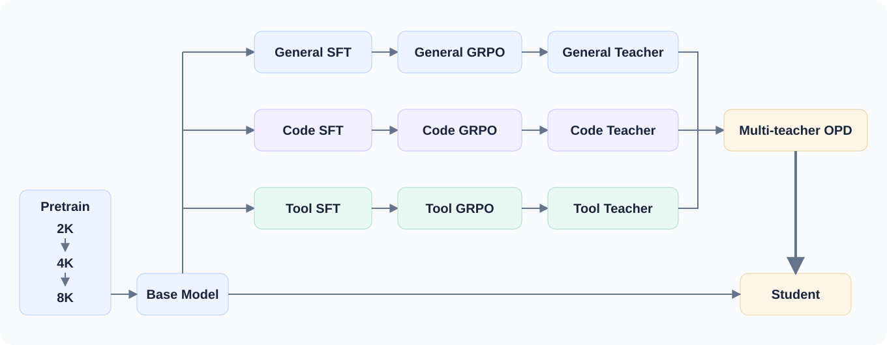
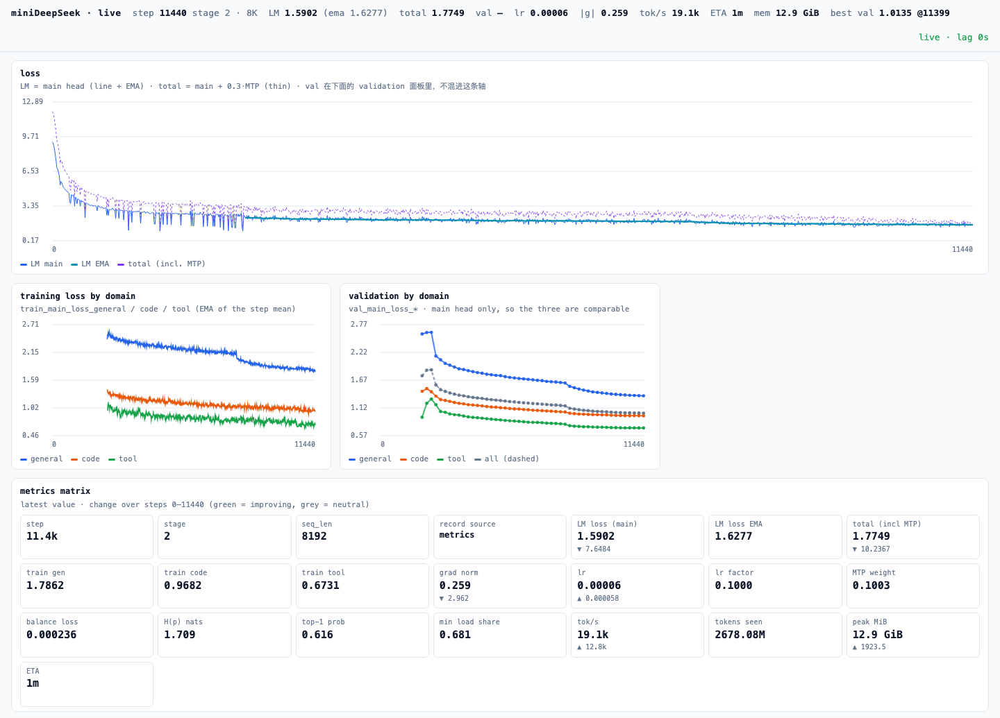
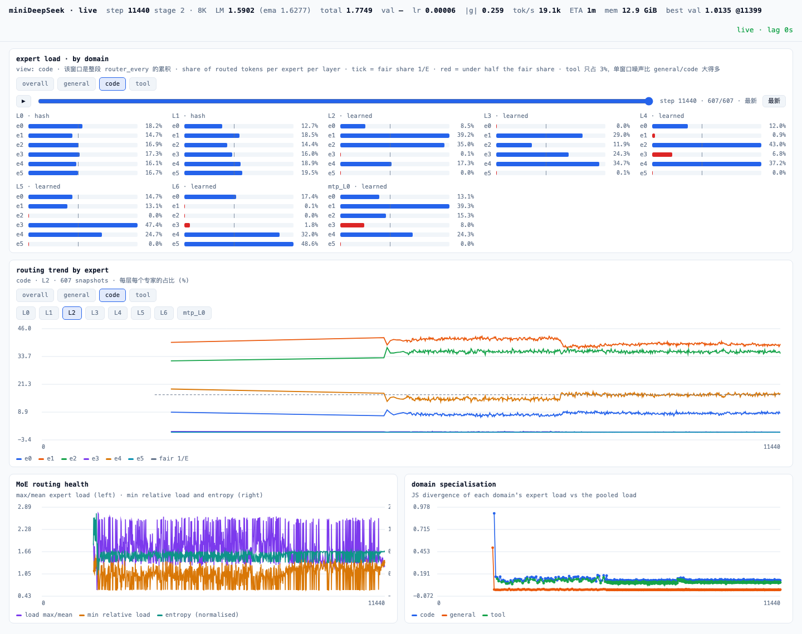
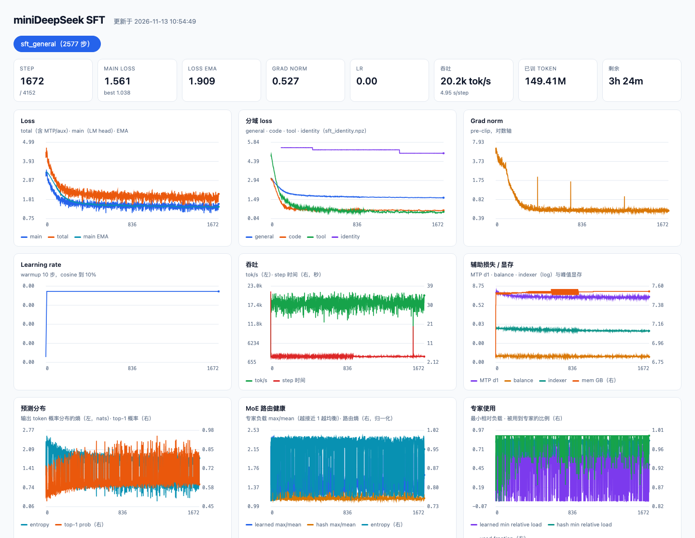
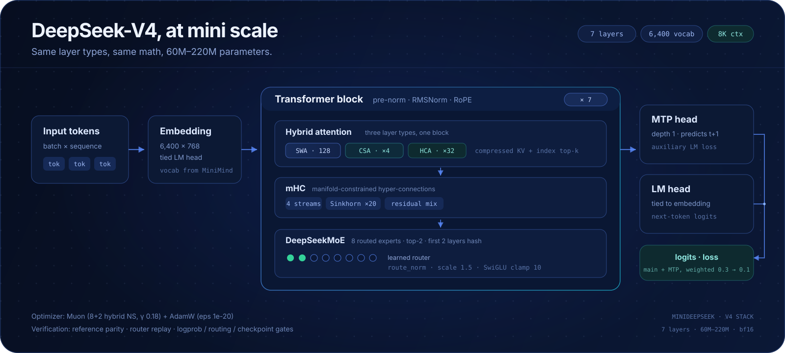

<div align="center">
  
</div>
<div align="center">


[](https://github.com/Alita02384/miniDeepSeek/stargazers)
[](LICENSE)
[](https://github.com/Alita02384/miniDeepSeek/commits)
[](https://github.com/Alita02384/miniDeepSeek/pulls)

</div>

<p align="center"><a href="README.md">中文</a> · <strong>English</strong></p>
<h3 align="center">Train your own LLM with the techniques behind DeepSeek-V4</h3>

<p align="center">
  <a href="https://modelscope.cn/datasets/Alita0429/mini-deepseek">Training dataset</a> ·
  <a href="https://modelscope.cn/models/Alita0429/miniDeepSeek/files">Pretrained weights</a> ·
  <a href="#training-reports">Training reports</a> ·
  <a href="#quick-start">Quick start</a>
</p>

<p align="center"><b>145M parameters · DeepSeek-V4 architecture at small scale · Consumer GPUs</b></p>

# 🐳 About miniDeepSeek

If you're training your first language model, projects like nanoGPT and MiniMind make the classic Transformer accessible. But if you want to experiment with expert routing, compressed attention or multi-teacher distillation, the next step often means learning a cluster-oriented framework such as torchtitan or verl before you can even start training.

miniDeepSeek brings those techniques into a model you can train on a **single RTX 4090**. You can also train on multiple GPUs; I used **two RTX 4090Ds**. The model has approximately 145M total parameters, with about 60M active per token.

The architecture includes DeepSeekMoE, hash routing, auxiliary-loss-free load balancing, MLA, CSA/HCA, mHC, MTP and SwiGLU clamping. The training pipeline uses Muon + AdamW, a 2K → 4K → 8K pretraining curriculum, specialist supervised fine-tuning (SFT), GRPO and multi-teacher on-policy distillation (OPD).

Enjoy experimenting! 😊

**Training data:** [Download the dataset on ModelScope](https://modelscope.cn/datasets/Alita0429/mini-deepseek)
**Pretrained model:** [Download the weights on ModelScope](https://modelscope.cn/models/Alita0429/miniDeepSeek/files)

# 🎯 What you'll build

## 1. A 145M MoE model using DeepSeek's core techniques

Train a language model from scratch with **145.84M total parameters and 60.91M active parameters**.

| Technique | Implementation |
|---|---|
| DeepSeekMoE | Each token selects two of six routed experts. |
| Hash routing | The first two layers use a fixed token-ID mapping; later layers learn top-k routing from hidden states. |
| Auxiliary-loss-free load balancing | Router biases adjust the load across experts. |
| CSA / HCA hybrid attention | Sliding-window attention is combined with two forms of compressed attention. |
| MLA | Low-rank query and output projections. |
| mHC | Four residual streams are mixed using Sinkhorn iterations. |
| MTP | One auxiliary layer trains the model to predict additional future tokens. |
| SwiGLU clamp | Activations are bounded to limit extreme values. |
| Muon + AdamW | Muon updates the main hidden weight matrices; AdamW handles embeddings, the output head and other designated parameters. |

## 2. The DeepSeek-V4 training pipeline at small scale



<a id="training-reports"></a>

## 3. Training reports 📊

Training metrics are recorded alongside logs and checkpoints. The following reports from my own runs are available in `reports/`.

### Pretraining: 2K → 4K → 8K

[](https://raw.githack.com/Alita02384/miniDeepSeek/main/reports/curriculum_145m_3b_dashboard.html)

**MoE expert specialization and routing**

[](https://raw.githack.com/Alita02384/miniDeepSeek/main/reports/curriculum_145m_3b_dashboard.html)

[Open the pretraining dashboard](https://raw.githack.com/Alita02384/miniDeepSeek/main/reports/curriculum_145m_3b_dashboard.html) · [View the HTML file](reports/curriculum_145m_3b_dashboard.html)

### SFT: a snapshot of instruction tuning

[](https://raw.githack.com/Alita02384/miniDeepSeek/main/reports/sft_dashboard.html)

[Open the SFT dashboard](https://raw.githack.com/Alita02384/miniDeepSeek/main/reports/sft_dashboard.html) · [View the HTML file](reports/sft_dashboard.html)

<details>
<summary>Export your own reports</summary>

Merge the pretraining stages' metrics with `scripts/merge_metrics.py`, then export the dashboards:

```bash
# Pretraining
python3 scripts/live_dashboard.py --export pretrain_report.html --local-metrics metrics_full.jsonl

# SFT
python3 scripts/sft_dashboard.py --export sft_report.html --total-steps 4152
```

</details>

<a id="quick-start"></a>

# 🚀 Quick start

## Step 0: Set up the environment

```bash
git clone https://github.com/Alita02384/miniDeepSeek.git
cd miniDeepSeek
python3.12 -m venv .venv
.venv/bin/pip install -e '.[dev]'
```

<details>
<summary>Check the installation without a GPU or a dataset</summary>

```bash
./scripts/debug_smoke.sh
```

This runs a two-step training smoke test, consistency checks and the CPU test suite. The documented run reported `365 passed, 2 skipped`, covering the forward and backward passes, checkpoints and routing. If you just want to check your installation, you can stop here.

</details>

## I. Train the model

<details>
<summary>Check whether PyTorch can see CUDA</summary>

```python
import torch
print(torch.cuda.is_available())
```

Training targets CUDA and supports multiple GPUs. CPU and MPS are for checking the implementation and running the debug model. If you need a different PyTorch build, see the [PyTorch wheel index](https://download.pytorch.org/whl/torch_stable.html).

</details>

### 1. Download the data

Run these commands from the repository root:

```bash
.venv/bin/pip install -U modelscope

# Pretokenized pretraining data (about 3.4 GB compressed)
.venv/bin/modelscope download --dataset Alita0429/mini-deepseek packs.tar.zst \
  --local_dir data

# JSONL files for SFT, GRPO and OPD
.venv/bin/modelscope download --dataset Alita0429/mini-deepseek \
  --include '*.jsonl' --local_dir data

# The archive already contains the data/tokenization/ path
zstd -dc data/packs.tar.zst | tar -xf -
```

The pretraining scripts read the extracted packs directly from `data/tokenization/`. Post-training JSONL files are downloaded to `data/`; tokenize and pack them according to the corresponding training config.

### 2. Start training

<details>
<summary>Pause and resume training</summary>

All stages support checkpoint-based resumption:

- `train.auto_resume: true` resumes from the latest checkpoint in `out_dir`.
- `train.resume: <path>` selects a checkpoint explicitly.
- If `out_dir/final` already exists and the resume path points to an external base, training stops before it can overwrite the output.

Checkpoints store the model, optimizer and training progress. When the GPU count changes, progress is mapped to the new step count using the global token count.

</details>

#### 2.1 Pretraining (required)

The configuration generator adjusts the microbatch and gradient accumulation for the GPU count while keeping the budget at 262,144 tokens per step:

```bash
.venv/bin/python scripts/autoconfig_145m.py --gpus 2
NPROC_PER_NODE=2 bash scripts/train_curriculum.sh \
  configs/pretrain/generated/curriculum_145m_g2.yaml
```

Weights are saved under `checkpoints/curriculum_145m_3b/stage_*_seq*/final/`.

#### 2.2 Instruction tuning (required)

Point `train.resume` in `configs/sft/*.yaml` to your pretrained checkpoint, then run:

```bash
for spec in general code tool; do
  bash scripts/train_sft.sh configs/sft/$spec.yaml
done
```

Outputs: `checkpoints/sft_{general,code,tool}_145m/final/`. Only response tokens contribute to the supervised loss; the MTP loss weight decays from 0.3 to 0.1.

#### 2.3 GRPO (optional)

```bash
for spec in general code tool; do
  bash scripts/train_grpo.sh configs/grpo/$spec.yaml
done
```

The general specialist uses a 1.8B reward model, the code specialist uses unit tests, and the tool specialist receives tool-call rewards. For general GRPO, place `internlm2-1_8b-reward` (about 3.2 GB) in the repository root first. Outputs are saved under `checkpoints/grpo_{general,code,tool}_145m/final/`.

#### 2.4 Multi-teacher OPD (optional)

```bash
bash scripts/train_opd.sh configs/opd/three_teacher.yaml
```

The student generates its own trajectories. The general, code and tool teachers score those same trajectories, each contributing one third of the full-vocabulary reverse KL loss.

## II. Export the model

```bash
.venv/bin/python scripts/export_hf.py \
  --checkpoint checkpoints/sft_general_145m/final \
  --out hf/mini_145m_a60m --flavor mini_145m_a60m
```

Load the exported directory with `trust_remote_code=True`. The export uses the Hugging Face format for downstream integrations such as Transformers, verl and vLLM; runtime support depends on the backend.

# 📚 Data

## I. Tokenizer

miniDeepSeek uses MiniMind's **6,400-token BPE vocabulary** and ChatML template in [`tokenizer/`](tokenizer/). Tied embeddings take about 4.9M parameters, leaving more room for the model itself. The small vocabulary also makes full-vocabulary reverse KL in OPD and log-probability computation in GRPO affordable. **Keep the vocabulary fixed:** changing it requires retraining the weights and rebuilding all token packs.

## II. Pretraining data

The budget was 3B tokens: 262,144 tokens per step for 11,444 steps. With packs 76–95% full, the run consumed **2.68B tokens**. The mixture was **82% general, 15% code and 3% tool**. The three stages used non-overlapping data:

| Stage | Token budget | Sequence length |
|---|---:|---:|
| 2K | 0.450B | 2048 |
| 4K | 1.650B | 4096 |
| 8K | 0.900B | 8192 |

Sources include MiniMind `pretrain_t2t`, fineweb-edu, chinese-fineweb-edu, cosmopedia-v2, finemath, codeparrot-clean, and schema-to-call text from ToolACE and glaive. The pipeline removes exact duplicates across sources, selects examples by hash to meet the budget, and checks evaluation sets for 13-gram overlap.

```jsonl
{"text": "Transformers use self-attention to model relationships between tokens in context."}
```

## III. SFT data

Each specialist has its own dataset with response-only masking: 70–90% domain data and 10–30% general data.

| Specialist | Documents | Tokens contributing to loss | Steps per target epoch |
|---|---:|---:|---|
| general | 877,651 | 359.1M | 4,152 |
| code | 148,723 | 24.5M | 480 |
| tool | 99,552 | 6.9M | 285 |
| identity | 69 | 2.2k | Mixed into general at weight 0.0002 |

All three domains target one epoch in `configs/pipeline/posttrain_e2e_145m.yaml`. At weight 0.0002, the small identity set is seen about 15 times to teach the model how to answer “Who are you?” [`scripts/scrub_identity.py`](scripts/scrub_identity.py) removes legacy MiniMind identity strings (including `jingyaogong` and `minimind`) and replaces them with this project's identity.

```jsonl
{"conversations": [{"role": "user", "content": "Hello"}, {"role": "assistant", "content": "Hello!"}]}
```

## IV. Reinforcement learning data

- **General GRPO:** `data/grpo_general_train.jsonl` contains 17,460 prompts. A 1.8B reward model is combined with length, thinking and repetition penalties.
- **Code GRPO:** filtered executable tasks from MBPP and open-r1, scored with unit tests and weighted compilation/format checks.
- **Tool GRPO:** `data/grpo_tool_train.jsonl` contains 33,960 prompts. Rewards cover tool calls and argument correctness.
- **OPD:** a pool of 9,135 prompts, three domain teachers and full-vocabulary reverse KL.

```jsonl
{"prompt": "Write a function that returns the mean of a list.", "reference_answer": "def mean(xs): ...", "rubric": "unit_test"}
```

## V. Dataset files

The [ModelScope dataset](https://modelscope.cn/datasets/Alita0429/mini-deepseek) includes the prepared pretraining packs and the JSONL files:

```text
packs.tar.zst      # Tokenized 2K/4K/8K pretraining data (train + validation); ~3.4 GB compressed
*.jsonl            # Pretraining, SFT, GRPO, OPD and evaluation records
SHA256SUMS         # Checksums for verifying the download
```

# 🧠 Model

## Architecture

The model follows the computations used by the V4 components at a smaller scale:

- **Hybrid attention:** seven layers follow `(0, 0, 4, 32, 4, 32, 4)`, with a 128-token sliding window, CSA compression ratio 4 and HCA compression ratio 32. The CSA indexer selects the top 1,024 entries at 4K or 2,048 at 8K.
- **mHC:** four residual streams mixed with 20 Sinkhorn iterations.
- **DeepSeekMoE:** token-ID hash routing in the first two layers and learned top-k routing thereafter, with `route_norm`, `route_scale=1.5` and an auxiliary-loss-free balancing bias.
- **MTP:** one auxiliary prediction layer; the loss weight decays from 0.3 to 0.1.
- **Other components:** SwiGLU clamp at 10.0, MLA with rank-288 q/o projections, tied embeddings, and Muon + AdamW.

<div align="center">
  
</div>

The implementation is organized by component in [`src/minideepseek/model/`](src/minideepseek/model/). The state-dict keys and tensor shapes follow the corresponding reference implementation for direct comparison and loading.

## Configuration

| Model | Total / active parameters | Layers | FFN | Routing | Use |
|---|---:|---:|---|---|---|
| `mini_145m_a60m` | 145.84M / 60.91M | 7 | 6 routed experts | top-2 | Main training runs |

Key settings: `dim=768`, 7 decoder layers + 1 MTP layer, `n_heads=12`, `head_dim=64`, `vocab=6400`, `seq_len=4096`, `max_context=8192`, `swiglu_limit=10.0`, `hc_mult=4`, and `sinkhorn_iters=20`. See the [full model config](configs/model/mini_145m_a60m.yaml). CPU tests use a separate 12.98M-parameter `debugmodel`.

# 🧪 Experiments

## I. Training costs

Measurements use bf16 on two RTX 4090Ds or one 24 GB RTX 4090.

| Measurement | Result | Conditions |
|---|---:|---|
| Pretraining throughput | 30k tokens/s; 10.4 s/step | 2×4090D, DDP, 262,144 tokens/step |
| SFT throughput | 18–20k tokens/s | 2×4090D, DDP, 4K, microbatch 8192×2, gradient accumulation 16, 7.5 GiB |
| GRPO step time | 18.6 s | 1×4090, 16 prompts × 6 samples × 512 tokens, 9.0 GiB |
| KV-cache decoding | 5.4 ms/step ≈ 12k tokens/s | 1×4090, batch size 64, CUDA graph |
| Three-teacher OPD | Total KL 0.065 over 20 steps | 9,135-prompt pool, about 17 s/step |

The full 2K → 8K pretraining run completed 11,444 steps and consumed 2.68B tokens. The table reports measurements rather than planned values.

## II. Training configurations and outputs

| Stage | Configuration | Budget | Output |
|---|---|---|---|
| Pretraining | `configs/pretrain/curriculum_145m_4x4090.yaml` | 11,444 steps; 2.68B tokens consumed (3B budget) | `checkpoints/curriculum_145m_3b/` |
| SFT | `configs/pipeline/posttrain_e2e_145m.yaml` | 4,152 / 480 / 285 steps; one epoch each, 357M target | `checkpoints/posttrain_e2e_145m/sft_*/final/` |
| GRPO | `configs/pipeline/posttrain_e2e_145m.yaml` | 200 / 200 / 400 steps | `checkpoints/posttrain_e2e_145m/grpo_*/final/` |
| OPD | `configs/pipeline/posttrain_e2e_145m.yaml` | 100 steps | `checkpoints/posttrain_e2e_145m/opd_three_teacher/final/` |

## III. Training details

- **GRPO:** group size 6, 16 prompts per step, up to 512 new tokens, temperature 0.8, CISPO clip 0.2, KL coefficient 0 and `rollout_backend=cached`. The actor recomputes old log probabilities so the ratio starts at 1; this gives an on-policy REINFORCE-style update with a group baseline.
- **OPD:** the student samples trajectories; all three teachers contribute full-vocabulary reverse KL. The loss denominator stays fixed at `Σw_i` so a missing teacher does not increase the remaining teachers' weights.
- **Consistency checks:** log probabilities, routing decisions and checkpoint reloads are checked using the CPU debug model and two-process DDP.

# 🧰 Repository guide

## 📁 Directory layout

```text
miniDeepSeek/
├── src/minideepseek/
│   ├── model/        # Attention, compression, mHC, MoE, MTP, KV cache and routing
│   ├── data/         # JSONL, tokenization, packing, deduplication, manifests and data mixing
│   ├── train/        # Muon + AdamW, curriculum, schedules, metrics and trainer
│   ├── rl/           # Rollouts, GRPO, multi-teacher OPD, rewards, tools and agents
│   ├── consistency/  # Log-probability, routing and checkpoint checks
│   ├── eval/         # General, code, tool and math evaluations
│   └── viz/          # Self-contained HTML reports with inline SVG charts
├── configs/          # Model, pretraining, SFT, GRPO, OPD and evaluation configs
├── scripts/          # Setup, data, training, monitoring, benchmarks and export
├── tests/            # CPU tests using the debug model
├── tokenizer/        # MiniMind tokenizer (6,400 tokens) and chat template
└── assets/           # Logo, banner and architecture diagram
```

# 🙏 Acknowledgments

The architecture and training methods draw on the **DeepSeek-V4 technical report**. Reference implementations and engineering ideas come from [torchtitan](https://github.com/pytorch/torchtitan), [verl](https://github.com/volcengine/verl) and [MiniMind](https://github.com/jingyaogong/minimind). The relevant parts were adapted into this repository's own modules, retaining their copyright notices and attribution. There is no runtime dependency on those repositories. MiniMind also inspired the README's visual style and organization.

The tokenizer and base data come from MiniMind. External corpora remain subject to their respective licenses.

## License

The project's code, data and models are released under the [MIT License](LICENSE).

> The DeepSeek name and blue whale mark belong to DeepSeek. The whale used here is an unofficial tribute and does not imply endorsement. The logo lettering uses Fredoka and DM Serif Display (SIL OFL), converted to paths. See the [asset notes](assets/README.md).

If this project helps you, consider starring the repository, opening an issue or submitting a pull request.
